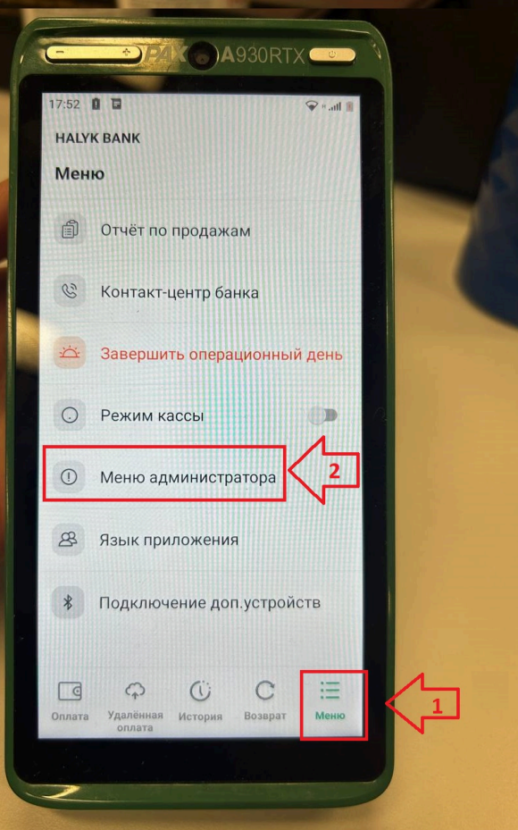
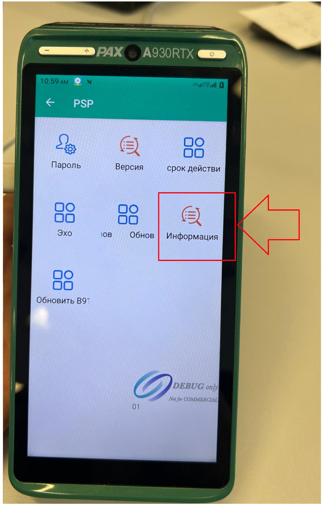
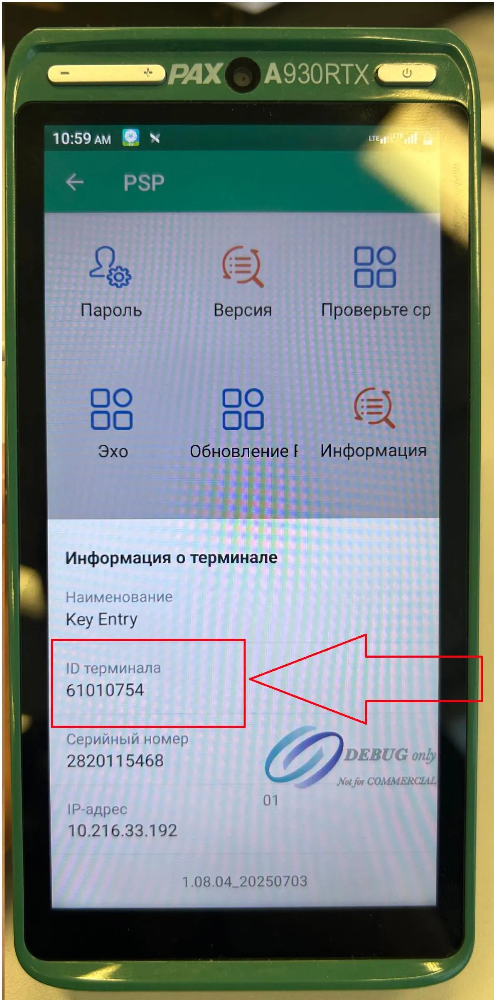

# HALYK POS: Инструкция по получению Terminal ID

Terminal ID — идентификатор POS-терминала. Чтобы найти его, выполните следующие шаги на нужном терминале Halyk.

1. Нажмите **«Меню»** в правом нижнем углу экрана.
2. Откройте **«Меню администратора»**.
   
3. Если терминал запросит пароль, введите пароль администратора. В исходной инструкции указаны варианты: **902002**, **000000** или **999999**.
4. Откройте раздел **«Информация»**.
5. Найдите **Terminal ID** и запишите его полностью либо сфотографируйте экран с идентификатором.

