# Внешнее меню v2 и API Key

Сначала проверьте доступы, подготовьте внешнее меню, затем настройте интеграцию Cloud API и проверьте загрузку меню в Halyk Рестораны.

> ℹ️ **Выберите сценарий:** для отображения меню нужны внешнее меню и API-ключ. Для самовывоза дополнительно нужны тип оплаты и права доставки — выполните шаг 2. Для базовой QR-оплаты API-ключ не требуется.

> 📌 **Скриншоты — примеры интерфейса.** Выбирайте свой ресторан, торговые точки и терминальные группы. Email и даты на изображениях не копируйте. Название интеграции на промежуточных скриншотах отличается; итоговое имя указано перед проверкой в шаге 6.5.

## Перед началом: проверьте доступы

- **iikoOffice или iikoChain:** вход в систему нужного ресторана и доступ к **«Отчеты → Отчеты iikoWeb»**.
- **iikoWeb:** доступ к приложениям **«Настройки Cloud API»** — `APP_TRANSPORT_CONFIG` и **«Внешние меню»** — `APP_EXTERNAL_MENU`.
- **Cloud API:** убедитесь у дилера, что сервис доступен ресторану по его лицензии.
- **Только для самовывоза:** доступ к **«Розничные продажи → Типы оплат»** и возможность создать и сохранить тип оплаты.

> ⚠️ **B\_APT — «Просматривать типы оплаты».** Одного права просмотра недостаточно, чтобы гарантировать создание и сохранение. Если нужное действие недоступно, обратитесь к дилеру iiko для проверки прав.

### Только для самовывоза: права сотрудника на кассе

Права доставки настраивает техническая поддержка дилера; набор зависит от операций сотрудника. Раздел на кассе: **дополнительное меню iikoFront → Сервис → Доставка**.

| Право | Назначение |
| --- | --- |
| `D_CND` | Подтверждать доставки |
| `D_ED` | Редактирование доставки |
| `D_MD` | Управление доставкой |

## 1. Войдите в iikoOffice / iikoChain

1. Откройте iikoOffice; для сети используйте принятую в ресторане систему iikoChain.
2. Авторизуйтесь под учётной записью с нужными правами.
3. Проверьте, что открыта система нужного ресторана.

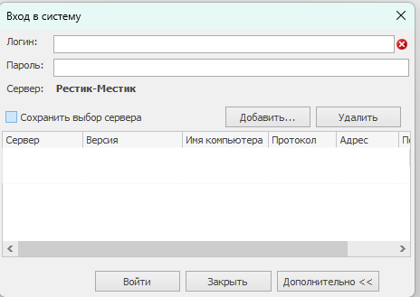

## 2. Подготовьте тип оплаты — только для самовывоза

> ℹ️ Если подключаете только отображение меню, переходите к шагу 3. Если тип оплаты уже создан, проверьте его настройки.

Откройте **«Розничные продажи → Типы оплат»** и нажмите **«Добавить»**.

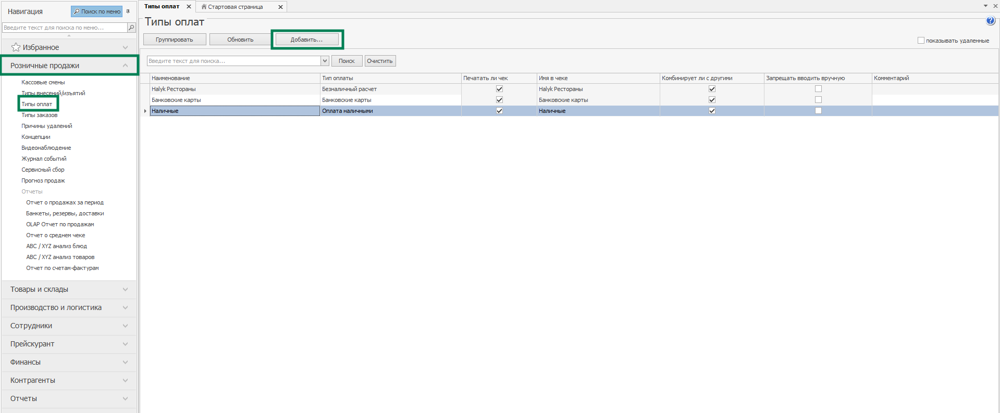

В форме типа оплаты заполните настройки и сохраните:

- **Наименование и название на чеке:** `HALYK самовывоз`.
- **Код:** `HALYK`.
- **Тип:** «Банковские карты».
- **«Может приниматься извне»:** включено.
- **Проведение оплаты:** «Как внешний, так и на стороне ресторана».
- Остальные параметры сверяйте со скриншотом и настройками ресторана по отдельной инструкции ниже.

> ⚠️ **До сохранения проверьте точные значения:** название — `HALYK самовывоз`, код — `HALYK`. Не подменяйте этот тип оплаты типом оплаты базового QR-сценария.

[iiko — создание типа оплаты для заказов на самовывоз Halyk Рестораны](payment-type-pickup.md)

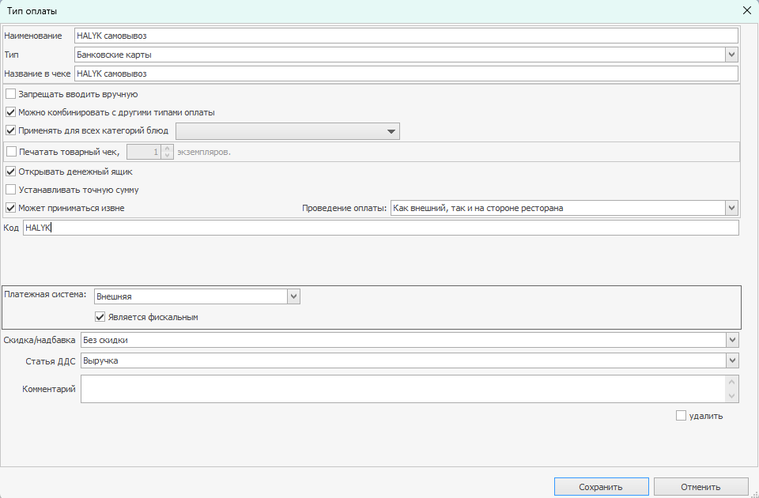

**Если используется iikoChain:** выберите торговые точки, где будет применяться этот тип оплаты, и сохраните изменения. Убедитесь, что тип оплаты доступен нужной точке.

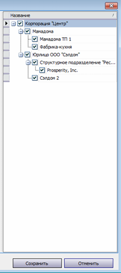

## 3. Проверьте готовность номенклатуры

### Как обновляется внешнее меню

- Меню **не синхронизируются с номенклатурой автоматически** и могут отличаться друг от друга.
- **Модификаторы во внешнем меню обновляются автоматически**: любые изменения в них в основном меню iiko сразу применяются во всех внешних меню, где они используются.
- Для полного обновления состава и данных блюд во внешнем меню необходимо запускать **ручное обновление**.

### Ограничения внешнего меню

При создании внешнего меню важно учитывать следующие ограничения:

- Блюдо должно быть **выставлено на продажу**: у него должны быть указаны цена и места продаж;
- **Не поддерживаются блюда, которые можно делить пополам**, т.е. блюда, для которых активна опция **Блюдо можно разделить** в схеме модификаторов;
- Возможен только **один уровень категорий** — вложенные подкатегории не создаются;
- Шкалы размеров блюда и его модификаторов **должны совпадать**. Если у блюда есть размеры S, M, L, а у модификатора — только S, M, он не будет выгружен в меню;
- В артикулах позиций во внешнем меню **не должно быть тире или дефисов** — блюда с такими артикулами не будут передаваться.

## 4. Создайте и сохраните внешнее меню

### 4.1. Перейдите в iikoWeb

В iikoOffice / iikoChain откройте **«Отчеты → Отчеты iikoWeb»**.

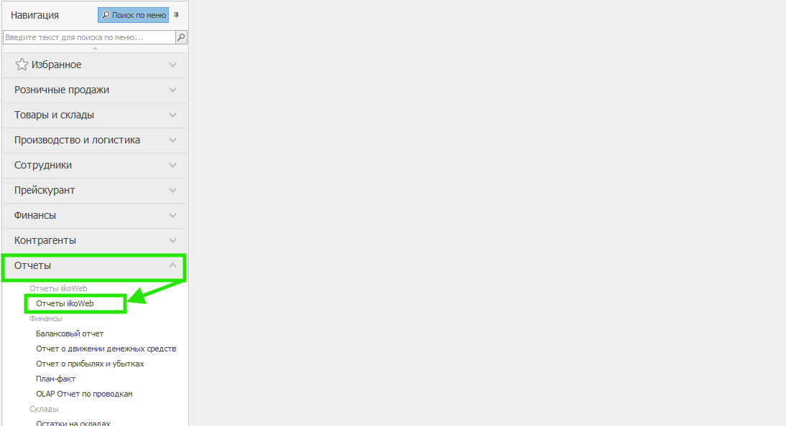

### 4.2. Авторизуйтесь в iikoWeb

Войдите под учётной записью ресторана. В показанном сценарии используются логин и пароль iikoOffice; если они не подходят, уточните доступ у администратора или дилера.

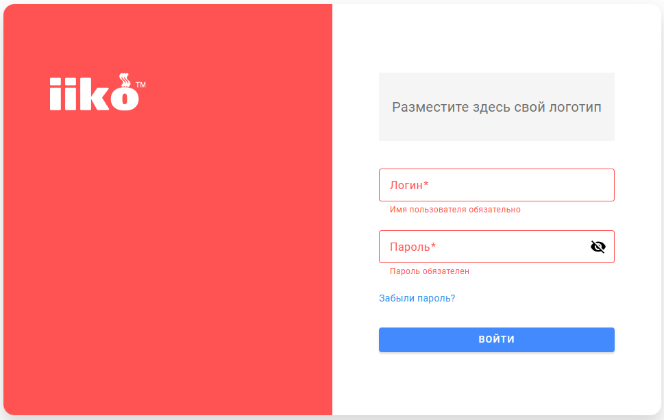

### 4.3. Откройте «Внешние меню»

На главной странице в блоке **«Внешние заказы»** выберите **«Внешние меню»**.

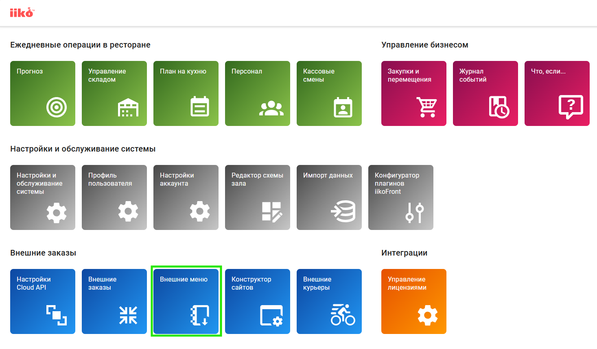

### 4.4. Добавьте меню

Нажмите **«Добавить»**.

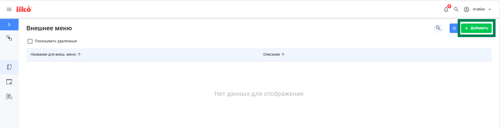

Доступно два способа создания внешнего меню:

- вручную;
- автоматически.

> ⚠️ **Название меню:** в этой инструкции и на её скриншотах — `Halyk QR Menu`. В основной инструкции онбординга встречается `HALYK QR Menu`. Чувствительность сервиса к регистру не подтверждена: при существующем меню выберите именно его в настройках API, не создавайте дубль только из-за регистра. Если портал не находит меню, сверьте требуемое написание с инженером Halyk.

Заполните форму:

1. **«Наименование»** — `Halyk QR Menu`, как в текущей инструкции; учитывайте примечание о различии написания выше.
2. **«Ресторан для загрузки цен»** — подключаемый ресторан.
3. **«Источник цен»** — нужный прайс-лист ресторана; на скриншоте выбран **«Базовый прайс-лист»**.
4. При необходимости заполните описание.
5. Выберите способ создания и нажмите **«Сохранить»**.

- **Ручной способ** позволяет полностью контролировать состав и вид меню. Подходит для меню со сложной структурой, отличающейся от основного справочника номенклатуры.
- **Автоматический способ («Сгенерировать меню»):** меню создается автоматически на основе вашего справочника номенклатуры: во внешнее меню попадут все блюда, у которых указаны цена и место продажи. Для каждого элемента во внешнем меню будут заполнены поля в соответствии с карточкой блюда: картинки, названия блюд, описания и т.д.

**При вложенных папках** в меню попадут папки, содержащие блюда. Например, подпапки «Мороженое» и «Торты» внутри «Десерты» станут двумя отдельными категориями внешнего меню.

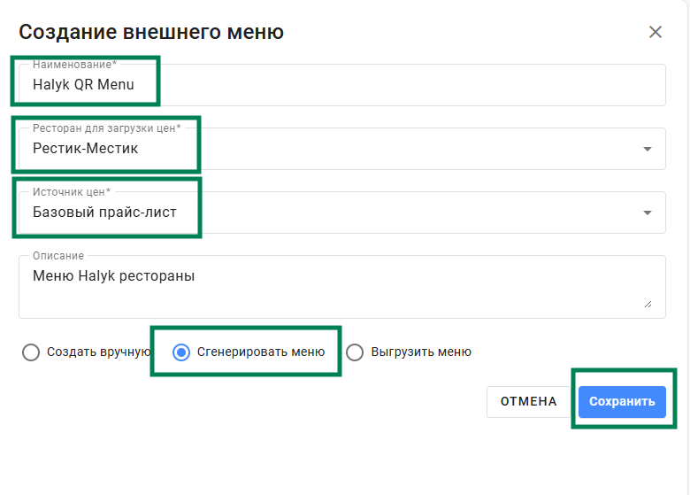

### 4.5. Проверьте состав и отредактируйте меню

1. Откройте созданное меню и вкладку **«Список блюд»**.
2. При необходимости включите **«Редактирование»**.
3. Проверьте категории, блюда, цены, изображения, размеры и модификаторы.
4. При ручном создании добавьте категории и блюда: пустое меню не готово к подключению.
5. После правок нажмите **«Сохранить»**.

> ✅ **Перед переходом к API:** меню сохранено, содержит нужные блюда и цены правильного ресторана.

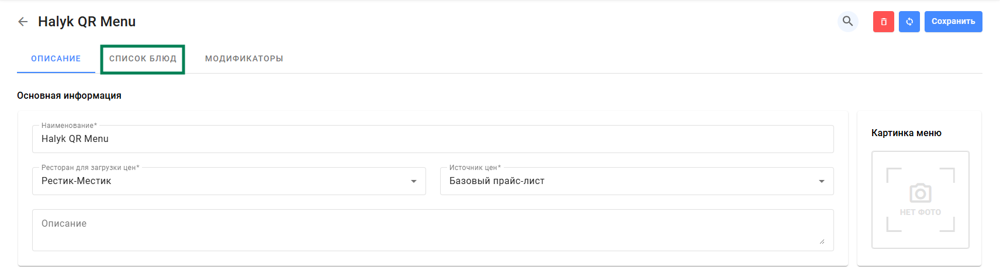

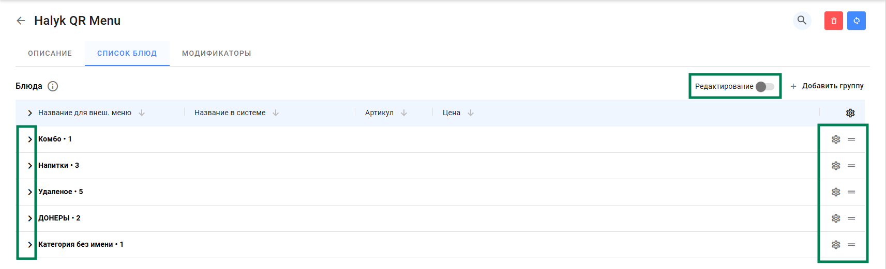

При необходимости автоматически сгенерированное меню можно отредактировать:

- **изменить порядок отображения элементов внутри группы:**
  - раскройте список группы;
  - нажмите кнопку перемещения и перетащите позицию на нужное положение;
- **изменить порядок отображения групп**:
  - нажмите кнопку перемещения в строке с названием группы и перетащите ее на нужное положение;
- **удалить группу**:
  - нажмите иконку редактирования в строке с названием группы;
  - выберите опцию **Удалить группу**;
- **задать расписание для той или иной категории**:
  - нажмите иконку редактирования в строке с названием группы;
  - в поле **Расписание** выберите один из доступных периодов продажи категории;
- **изменить цену блюда**:
  - откройте карточку нужного блюда на вкладке **«Список блюд»**;
  - в блоке **Детали** измените цену. Указанная цена применится к блюду только в этом внешнем меню.

## 5. Обновляйте меню при изменении номенклатуры

Этот шаг нужен при изменениях данных. При первом подключении, если состав и цены уже проверены, переходите к шагу 6.

### Обновление всего меню

> ⚠️ **Обновление заменяет выбранные поля значениями из номенклатуры.** Перед подтверждением проверьте галочки, особенно «Цены», чтобы не перезаписать вручную настроенные значения внешнего меню.

Справочник номенклатуры и внешнее меню не синхронизируются автоматически. Чтобы применить изменения, выполните следующие действия:

1. Нажмите кнопку обновления данных.
2. В открывшемся окне выберите поля для синхронизации.
3. Нажмите **Обновить**.

   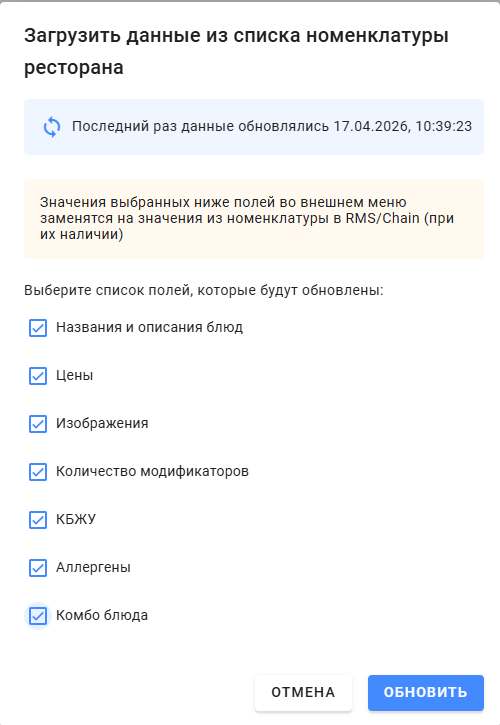

### Обновление одного блюда

1. Откройте карточку блюда во внешнем меню.
2. Нажмите кнопку обновления и подтвердите действие.
3. Проверьте результат.

> ⚠️ **Описание блюда этим действием не обновляется.** Чтобы перенести описание из номенклатуры, выполните обновление всего меню и выберите поле «Названия и описания блюд».

После обновления проверьте данные также на стороне Halyk Рестораны.

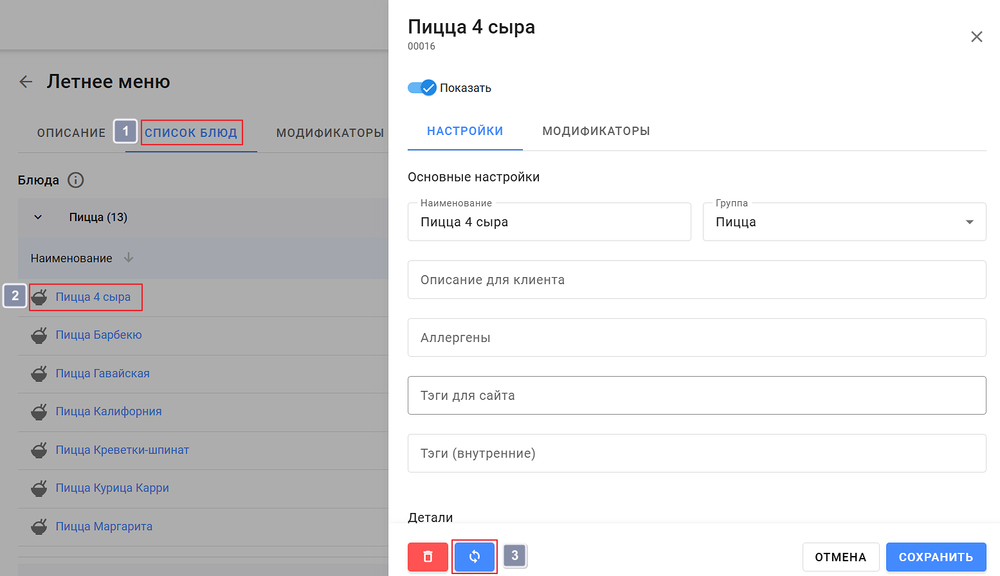

---

## 6. Настройте интеграцию Cloud API

### 6.1. Откройте настройки

В iikoWeb откройте **«Внешние заказы → Настройки Cloud API»**.

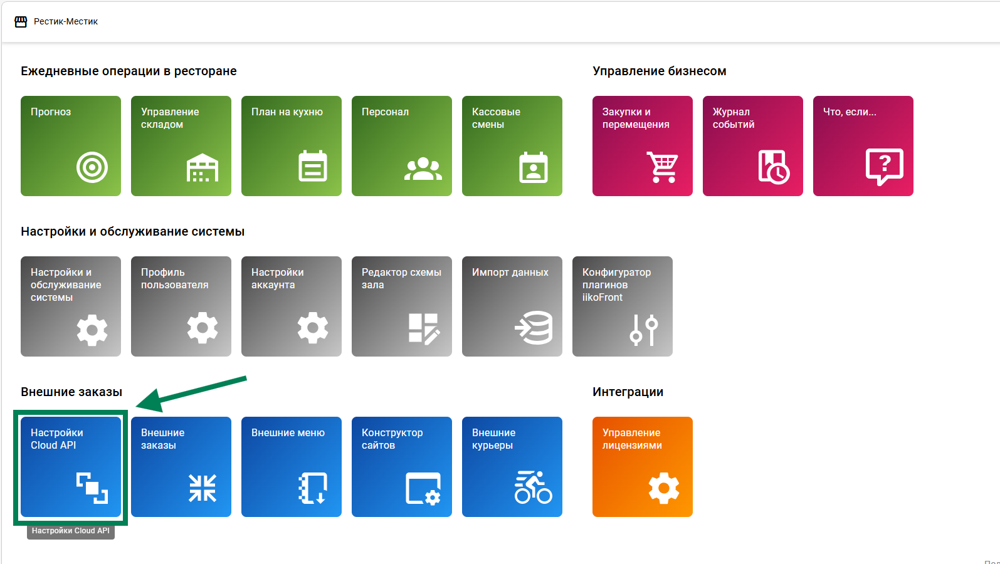

### 6.2. Создайте интеграцию

На вкладке **«Интеграции»** нажмите **«Добавить интеграцию»**. Откроется карточка API-логина.

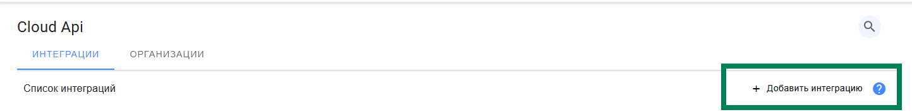

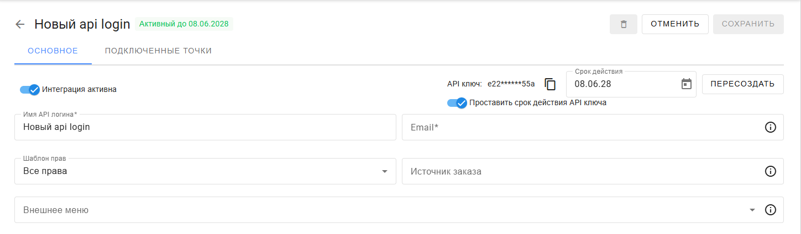

### 6.3. Подключите нужный ресторан

Перейдите на вкладку **«Подключенные точки»**.

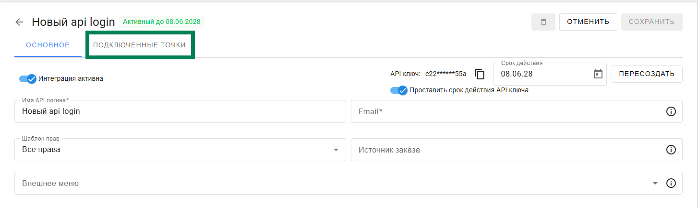

Нажмите **«Добавить точку»**.

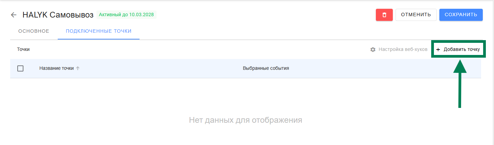

Отметьте **нужное заведение** и нажмите **«Добавить»**.

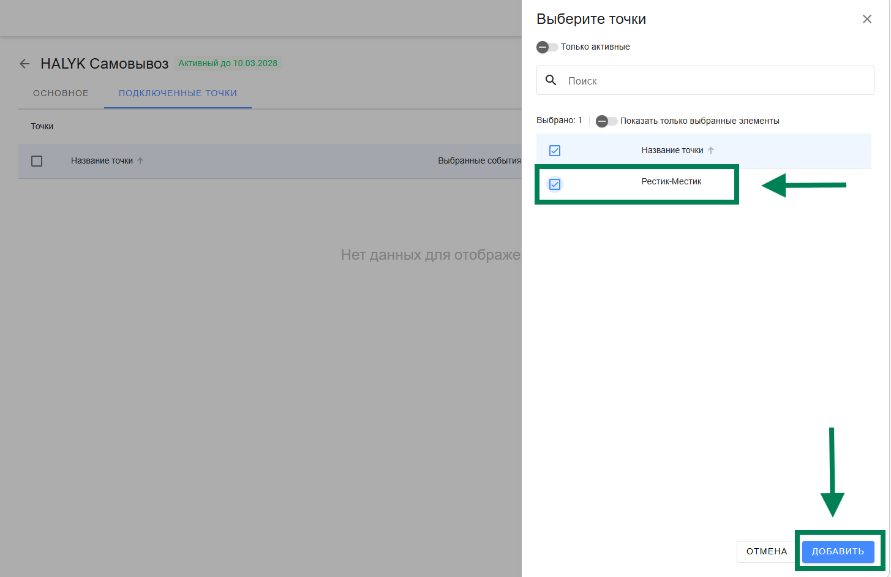

Проверьте, что нужный ресторан появился в списке. Сохраните настройки. Если форма требует заполнить обязательные поля, сначала выполните шаг 6.4 и затем сохраните всю интеграцию.

> ⚠️ Проверяйте принадлежность точки текущему ресторану. Добавление ресторана в интеграцию и разрешение доступа к терминальной группе — **разные действия**; шаг 7 также обязателен.

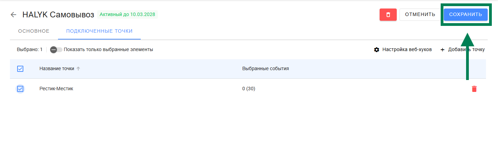

### 6.4. Заполните основные поля

Перейдите на вкладку **«Основное»**.

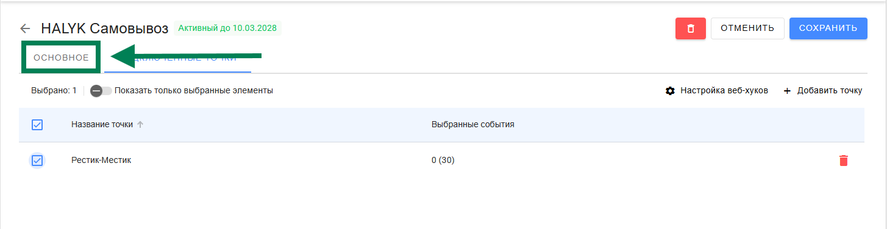

**Email:** укажите действующий адрес ответственного за интеграцию для уведомлений Cloud API.

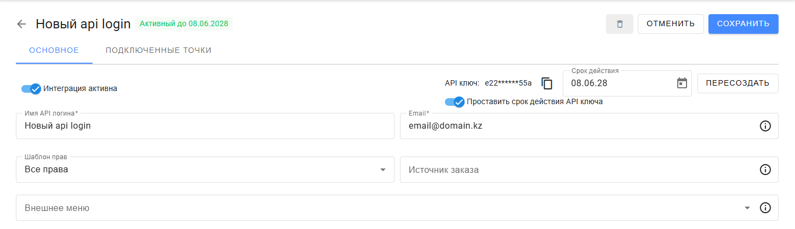

**«Шаблон прав»:** выберите **«Все права»**, как в текущей схеме подключения Halyk и на скриншоте. Это широкие права; возможность более узкого шаблона для этой интеграции должна быть проверена её ответственным специалистом.

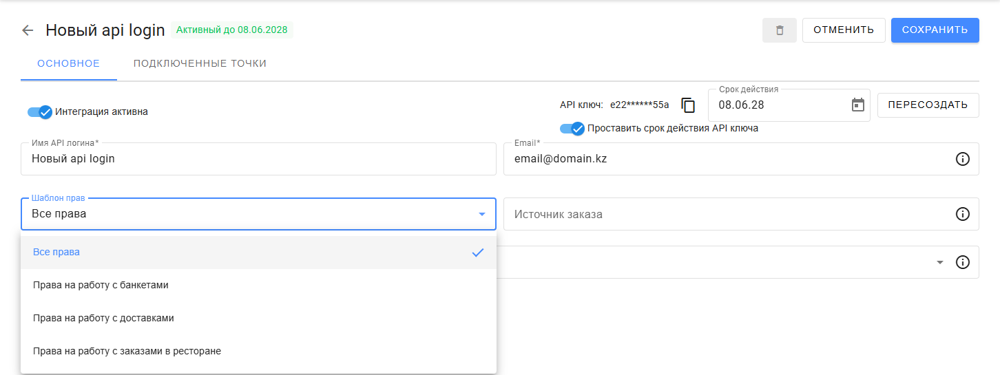

**«Источник заказа»:** укажите `Halyk Рестораны`, как на скриншоте.

> 📌 Это поле не только подписывает заказы: по справке iiko заполненный источник ограничивает видимость через API заказами с этим источником. Не заменяйте значение произвольным названием ресторана.

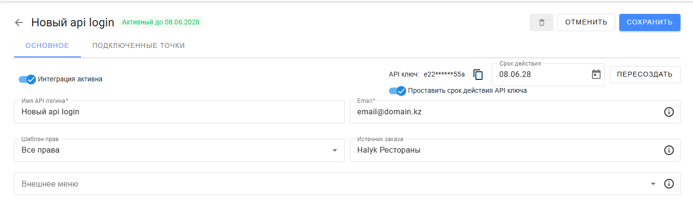

**«Внешнее меню»:** выберите созданное меню **Halyk QR Menu** для текущего ресторана. Убедитесь, что оно отмечено в списке.

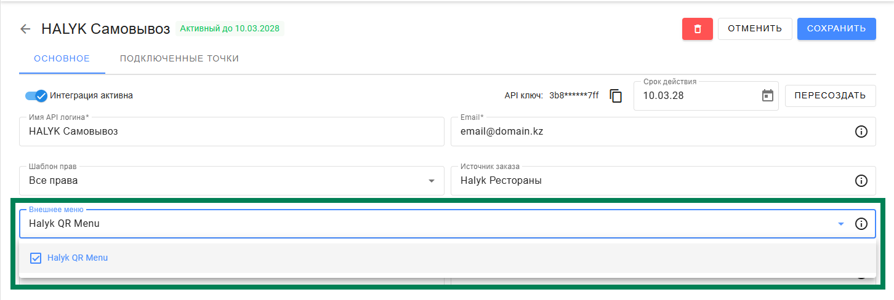

**«Источник цен» в карточке API:** выберите **«Внешнее меню»**.

> ⚠️ **Не путайте два поля «Источник цен».** При создании меню выбирается прайс-лист ресторана, а в API-интеграции в показанном сценарии выбирается **«Внешнее меню»**.

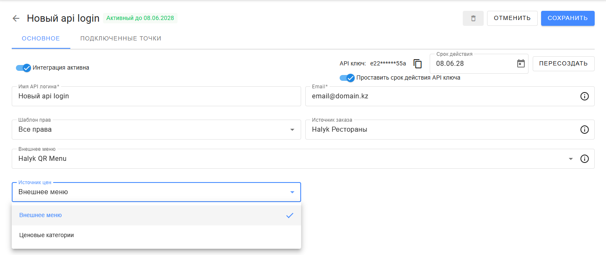

Включите **«Интеграция активна»** и проверьте **срок действия API-ключа**. По справке iiko срок можно задать от двух дней до двух лет; у нового ключа по умолчанию — два года. Укажите актуальную дату, а не дату со скриншота. Перед сохранением заполните имя API-логина следующим пунктом.

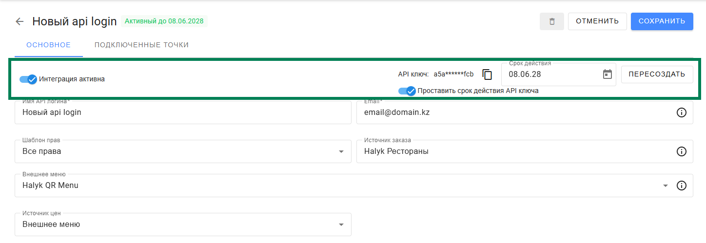

**«Имя API логина»:** укажите `Halyk рестораны-самовывоз`.

### 6.5. Проверьте поля и сохраните интеграцию

- [ ] Подключена нужная точка.
- [ ] Заполнены имя API-логина и действующий Email.
- [ ] Выбран шаблон прав.
- [ ] Источник заказа — `Halyk Рестораны`.
- [ ] Выбрано правильное внешнее меню.
- [ ] Источник цен — **«Внешнее меню»**.
- [ ] Интеграция активна, срок действия ключа не истёк.

**Нажмите «Сохранить» после заполнения всех полей, включая имя API-логина.**

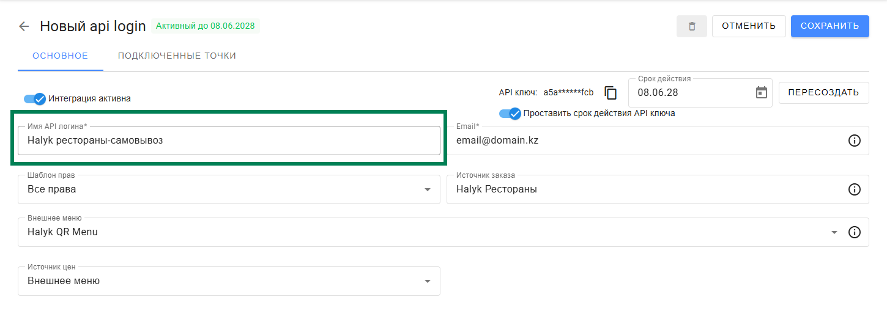

### 6.6. Скопируйте API-ключ

Скопируйте ключ кнопкой рядом с полем **«API ключ»**. После проверки организации по шагу 7 передайте его ответственному сервисанту Halyk Банка по согласованному рабочему каналу либо введите в поле API-ключа на портале при онбординге.

> 🔐 Копируйте ключ кнопкой — звёздочки на экране скрывают его значение. Не размещайте полный ключ в инструкции или общедоступных чатах. Для обычного копирования не нажимайте **«Пересоздать»**.

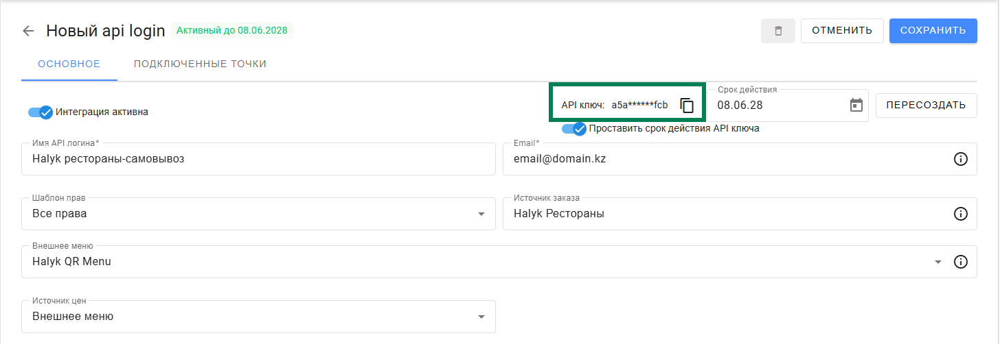

## 7. Разрешите выгрузку данных и доступ к терминальной группе

После сохранения интеграции нажмите стрелку назад, чтобы выйти из карточки API-логина.

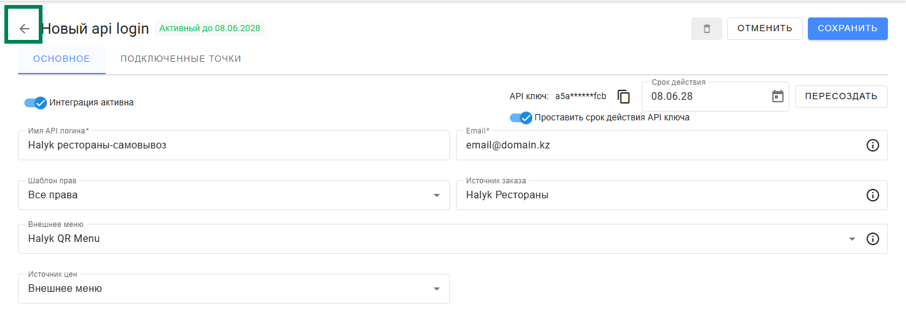

Откройте вкладку **«Организации»**.

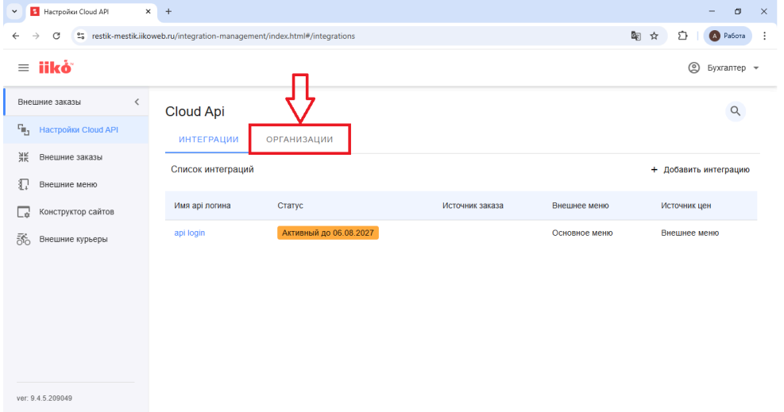

Нажмите на название **нужного ресторана**.

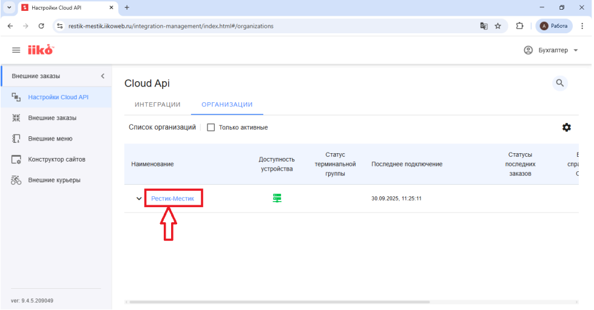

На вкладке **«Основное»** проверьте **обе настройки**:

1. Включено **«Разрешить выгрузку справочников в Cloud API»**.
2. В разделе **«Разрешить доступ к терминальным группам»** в столбце **«Данные»** отмечены нужные терминальные группы ресторана.
3. Нажмите **«Сохранить»**, если внесли изменения.

> ⚠️ Для самовывоза выбирайте группу кассы, которая будет принимать заказы. Проверьте доступность сервера и кассы в списке организаций; при недоступности обратитесь к дилеру iiko.

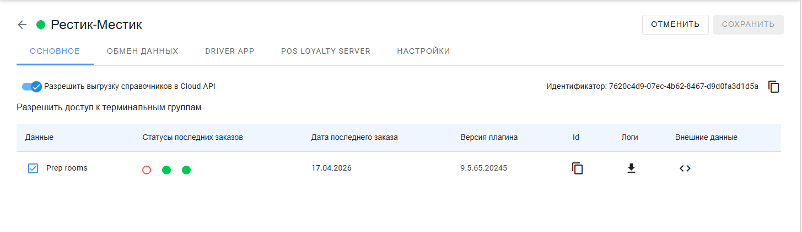

## 8. Проверьте загрузку в Halyk Рестораны

1. Вернитесь на портал и введите сохранённый API-ключ.
2. Дождитесь загрузки данных.
3. Выберите правильную **организацию** и **терминальную группу**.
4. Загрузите меню, проверьте категории, блюда, цены и принадлежность ресторану; сохраните.
5. Если подключается самовывоз, выполните тестовый заказ по основной инструкции: проверьте поступление на нужную кассу, состав, сумму, тип оплаты и прохождение статусов до закрытия.

[Подключение iiko к Halyk Рестораны — полная пошаговая инструкция](../../archive/iiko-connection-full-step-by-step.md)

> ✅ **Готово для отображения меню:** меню успешно загружено и сохранено в Halyk Рестораны, состав и цены проверены. **Готово для самовывоза:** дополнительно успешно пройден тестовый заказ. Само создание API-ключа ещё не подтверждает работоспособность подключения.

## 9. Если что-то не работает

| Проблема | Что проверить |
| --- | --- |
| Не открываются «Внешние меню» или Cloud API | Права APP\_EXTERNAL\_MENU / APP\_TRANSPORT\_CONFIG, доступы и лицензию с дилером. |
| Меню отсутствует в списке API или на портале | Создано ли и сохранено меню; выбрано ли оно в карточке API; подключена ли нужная точка; совпадает ли название с ожидаемым сервисом Halyk. |
| Нет организации или терминальной группы | «Подключенные точки», разрешение выгрузки справочников, галочку «Данные» у нужной терминальной группы и сохранение настроек. |
| Неверные цены | Ресторан и прайс-лист в меню; источник цен «Внешнее меню» в API; цены блюд после ручного обновления. |
| Не обновилось описание блюда | Обновите всё меню с выбранным полем «Названия и описания блюд»: обновление отдельной карточки описание не переносит. |
| API-ключ не принимается | Скопирован ли полный ключ без лишних пробелов; активна ли интеграция; не истёк ли срок; сохранены ли настройки. |
| Самовывоз не поступает или поступает на другую кассу | Организацию и терминальную группу на портале, доступность кассы, тип оплаты HALYK самовывоз / код HALYK и права доставки. |

## 10. Финальный чек-лист

- [ ] Внешнее меню создано, наполнено и сохранено.
- [ ] Проверены ресторан для загрузки цен, категории, блюда, цены и модификаторы.
- [ ] В API выбрано именно это меню; источник цен — «Внешнее меню».
- [ ] В интеграции подключён нужный ресторан.
- [ ] Имя API-логина, Email, источник заказа, права и срок действия проверены.
- [ ] Интеграция активна и сохранена после последних изменений.
- [ ] Разрешены выгрузка справочников и доступ к нужной терминальной группе; изменения сохранены.
- [ ] Меню успешно загружено и проверено на стороне Halyk Рестораны.
- [ ] Для самовывоза: тип оплаты и права доставки настроены, тестовый заказ завершён.

## Источники и границы проверки

Порядок действий и значения полей сверены со всеми 33 скриншотами этой страницы, связанными инструкциями Halyk и справкой iiko. Подключение к рабочему ресторану и тестовый заказ в рамках проверки документа не выполнялись.

- [iiko — настройка Cloud API](https://ru.iiko.help/articles/#!iikoweb-start/iikocloudapi)
- [iiko — внешнее меню: создание и основные действия](https://howto.iiko.help/articles/#!cafe/external-menu)
- [iiko — создание типа оплаты для заказов на самовывоз Halyk Рестораны](payment-type-pickup.md)
- [Подключение iiko к Halyk Рестораны — полная пошаговая инструкция](../../archive/iiko-connection-full-step-by-step.md)

**Требует подтверждения владельцем интеграции:** чувствительность поиска меню к регистру в названиях Halyk QR Menu / HALYK QR Menu; минимальный достаточный шаблон прав вместо используемого в исходной схеме «Все права».
