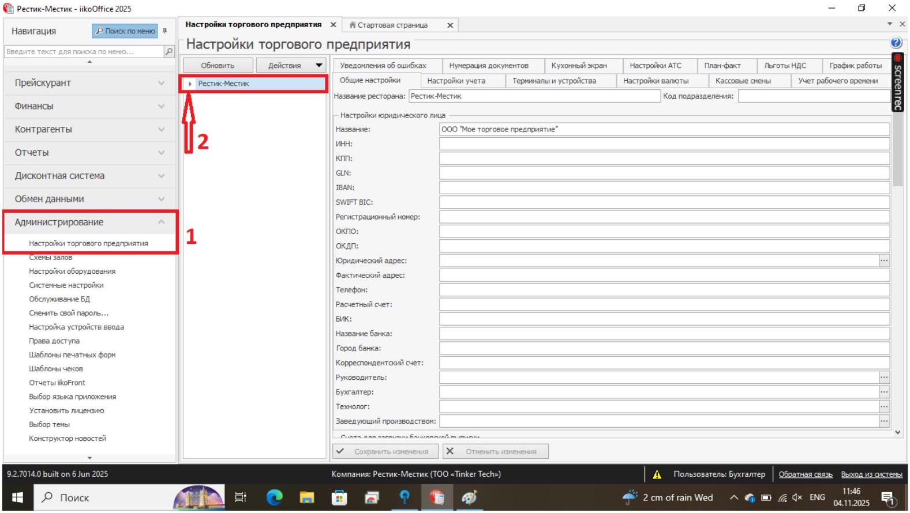
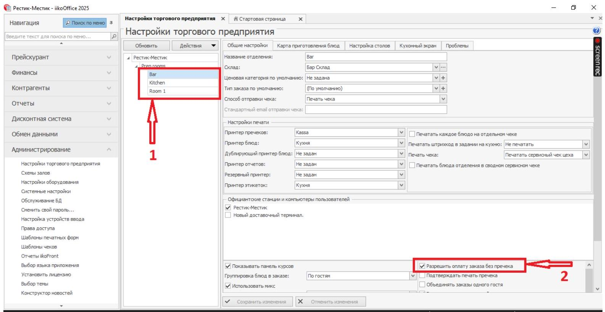
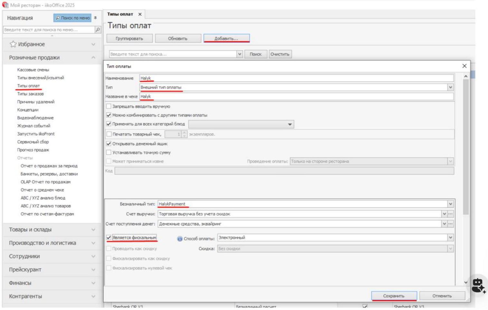

# iiko: создание оплаты для плагина Halyk Рестораны

> 📌 **Для работы сервиса обязательно заполните поля, подчёркнутые на скриншоте настройки типа оплаты.**
>
> Остальные поля **не обязательны для сервиса**, но могут быть обязательными по требованиям бухгалтерии заведения. Их заполнение согласуйте с сотрудником бухгалтерии.

## 1. Откройте настройки торгового предприятия

В **iikoOffice** перейдите в **«Администрирование» → «Настройки торгового предприятия»**.

## 2. Найдите терминальную группу заведения

Найдите нужное заведение и его терминальную группу. В неё входят отделения — секции заведения.

## 3. Разрешите оплату без пречека

Выберите нужное заведение и откройте **«Общие настройки»**.

Для **каждой секции** проверьте, что включён параметр **«Разрешить оплату заказа без пречека»**. Если галочка отсутствует, установите её. Сохраните изменения.

## 4. Создайте новый тип оплаты

В главном меню **iikoOffice** откройте **«Розничные продажи» → «Типы оплат»** и добавьте новый тип оплаты.

## 5. Заполните обязательные для сервиса поля

В открывшемся окне заполните **подчёркнутые поля на скриншоте ниже**. Укажите для них значения, показанные в примере.

**Обратите внимание именно на подчёркнутые поля: они обязательны для работы плагина Halyk Рестораны.**

Остальные поля заполняйте с учётом требований бухгалтерии заведения. Наличие значения в неподчёркнутом поле на скриншоте само по себе не означает, что это поле обязательно для сервиса.

## 6. Проверьте настройки и сохраните тип оплаты

Проверьте, что все **подчёркнутые поля** заполнены по примеру, а дополнительные поля — в соответствии с требованиями бухгалтерии. Сохраните новый тип оплаты.

> ⚠️ TODO: название и код QR-типа оплаты для плагина в тексте не указаны — значения есть только на скриншоте выше. Уточнить у инженера Halyk и вписать сюда текстом (они же нужны для проверки при тестовой оплате на этапе 8).
