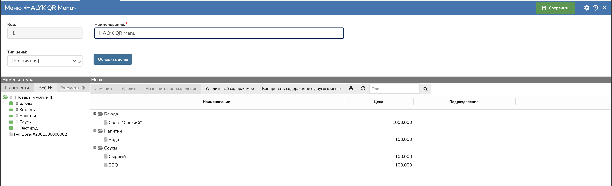

# Внешнее меню Paloma365

## Подключение меню для отображения гостям и для возможности включить самовывоз

> ℹ️ **Когда:** меню создаётся и выбирается на кассе на этапе [«2. Подготовка к подключению — Paloma365»](../../onboarding/02-preparation/paloma365.md). На портале меню для Paloma365 не выбирается, **API-ключ не вводится** — на шаге API-ключа нажмите **«Пропустить шаг»**. Проверка меню — этап [«7. Внешнее меню»](../../onboarding/07-external-menu/r_keeper-poster-paloma365-rosta.md).

### 1. Создайте меню в веб-интерфейсе

- Откройте веб-интерфейс Paloma365 и авторизуйтесь.
- На главной странице перейдите в раздел <b>«Меню»</b>.
- В списке меню создайте новое меню или выберите необходимое меню.
- Нажмите  “Добавить” для создания нового меню или “<b>Изменить”</b> (или дважды щелкните по нужному меню), чтобы открыть его для редактирования. 
- В карточке меню при необходимости укажите:

  - название меню;
  - тип цены;
  - другие параметры меню.

  

Обязательное условие: 1 уровень меню, не больше (как на фото)

- Перейдите на вкладку со структурой меню (дерево категорий и блюд).
- В левой части окна выберите нужную категорию.
- В центральной части отобразится список товаров (блюд), входящих в выбранную категорию.
- Для просмотра информации о блюде выделите его в списке. При необходимости можно открыть карточку блюда двойным щелчком.
- После внесения изменений сохраните их с помощью кнопки <b>«Сохранить»</b>.

### 2. Выберите меню на кассе

Далее что бы меню работало с сервисом Халык рестораны - необходимо на кассе его выбрать 

1. На кассе откройте **«Меню» → «Настройки» → вкладка «Плагины»**.
2. В блоке **«Платёжные системы»** в строке **«Использовать Halyk Рестораны»** нажмите **«Настройки»** — откроется окно плагина.
3. В поле **«Меню»** выберите созданное меню.
4. Нажмите **«Применить»**.

### Если что-то не так

- **Неверные цены в меню** — сверьте цены в меню Paloma365 и выбранный тип цены в карточке меню.
- **Нет товаров** — допускается только 1 уровень меню, вложенные уровни не поддерживаются.

> ⚠️ TODO: как обновлять меню в Halyk Рестораны после изменения номенклатуры в Paloma365, в источниках не описано — уточнить у инженера Halyk.
