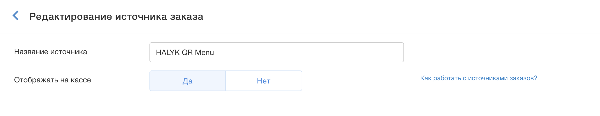
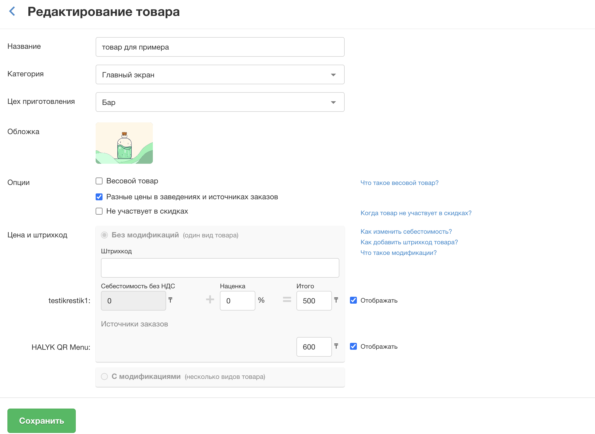

# Внешнее меню POSTER

## Подключение меню для отображения гостям и для возможности включить самовывоз

🛠️ Для создания внешнего меню тариф POSTER должен быть PRO или BUSINESS

## Для настройки внешнего меню создайте новый источник заказа или используйте уже настроенный заведением.

## 1️⃣  Создание источника заказа

1. Откройте **Настройки**.
2. Перейдите в раздел Заказы.
3. Нажмите **Создать источник заказа**.
4. Укажите:
   - **Название** источника (например: *Halyk Restaurants*, *Сайт*, *Доставка*).
   - Установите флажок **Отображать на кассе**  (**✓**).
5. Нажмите **Сохранить**.

---

##  **2️⃣** Проверка товаров источника заказа

1. Перейдите в раздел **Меню → Товары**. По умолчанию все товары уже привязаны к созданному источнику заказа.
2. Выберите товар, которого **не должно быть** во внешнем меню.
3. Откройте карточку товара.
4. В настройках отображения найдите строку с названием созданного источника заказа.
5. Скройте позицию для этого источника:
   - **товар** — снимите галочку **«Отображать»** возле названия источника;
   - **тех. карта (блюдо)** — выключите переключатель возле названия источника.
6. Сохраните изменения. Повторите только для блюд, которые нужно скрыть.
7. Проверьте категории и цены.

**Скрыть сразу целую категорию:** **Меню → Категории товаров → Ред.**, затем уберите в ней источник заказа Halyk Рестораны.

**Другие цены для Halyk Рестораны:** в карточке товара установите флажок **«Разные цены в заведениях и источниках заказов»** и задайте цену для источника.

> 📖 Официальная инструкция Poster: [Как работать с источниками заказов](https://knowledge-base.joinposter.com/ru/how-to-work-with-order-sources).

Остальные товары доступны для заказа через источник без дополнительных настроек.

---

---

важно: товары привязываются к источнику заказа по умолчанию, поэтому нет необходимости редактировать все меню — уберите галочку источника только у тех блюд, которые не должны отображаться во внешнем меню

---

## 3️⃣ Выбор меню при подключении (этап 3)

Источник заказа настраивается заранее, на этапе «2. Подготовка к подключению». Само меню выбирается на портале онбординга на этапе [«3. Подключение — Poster»](../../onboarding/03-connection/poster.md): после входа в аккаунт Poster (email и пароль) выберите **организацию**, соответствующую текущему ресторану, и нужное **меню**.

- Если организаций или меню несколько — проверьте, что выбранные данные относятся к нужной точке.
- Выбор меню на портале **не заменяет** настройки этой инструкции (тариф PRO / BUSINESS, источник заказа).
- **API-ключ в Poster не используется**: на шаге API-ключа портала нажмите **«Пропустить шаг»**.

Проверка меню после подключения — этап [«7. Внешнее меню»](../../onboarding/07-external-menu/r_keeper-poster-paloma365-rosta.md).

> ℹ️ **Как Halyk Рестораны находит меню.** Сервис ищет меню по **источнику заказа**: в Halyk Рестораны попадают товары, привязанные к созданному источнику заказа. Поэтому источник заказа обязателен, а набор блюд в меню настраивается привязкой товаров к нему.

> ℹ️ **Настройки для удалённого заказа (самовывоза) в Poster:**
> 1. Создайте **источник заказа** (категорию заказа) для Halyk Рестораны — по нему сервис вытягивает меню при подключении заведения.
> 2. Доступность блюда в меню ограничивается в **карточке товара**: включите или отключите галочку отображения для этого источника заказа.
