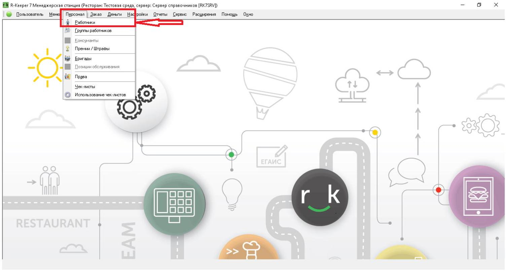
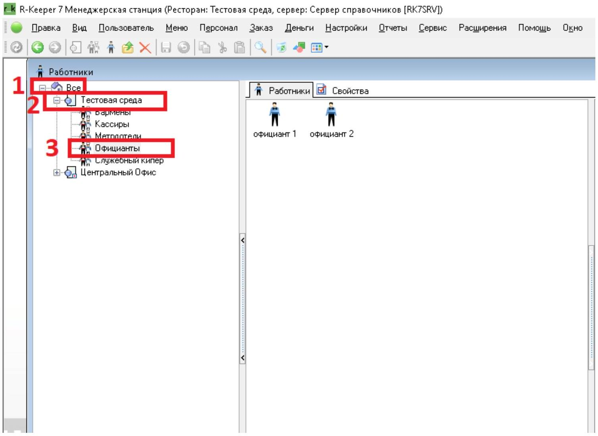
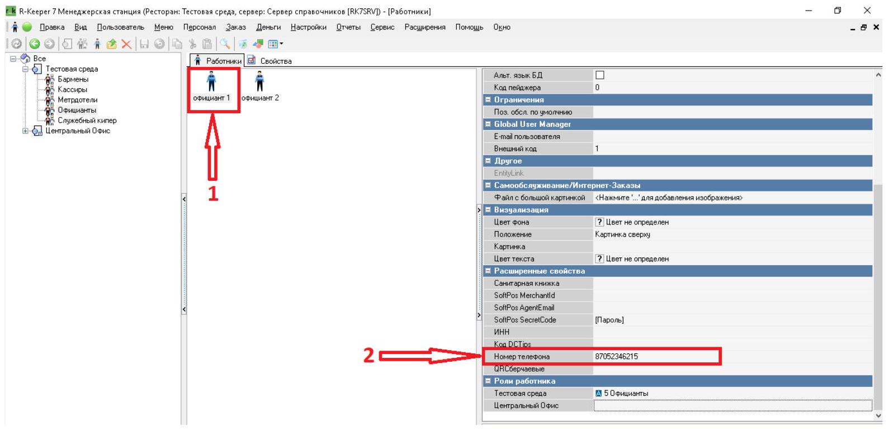
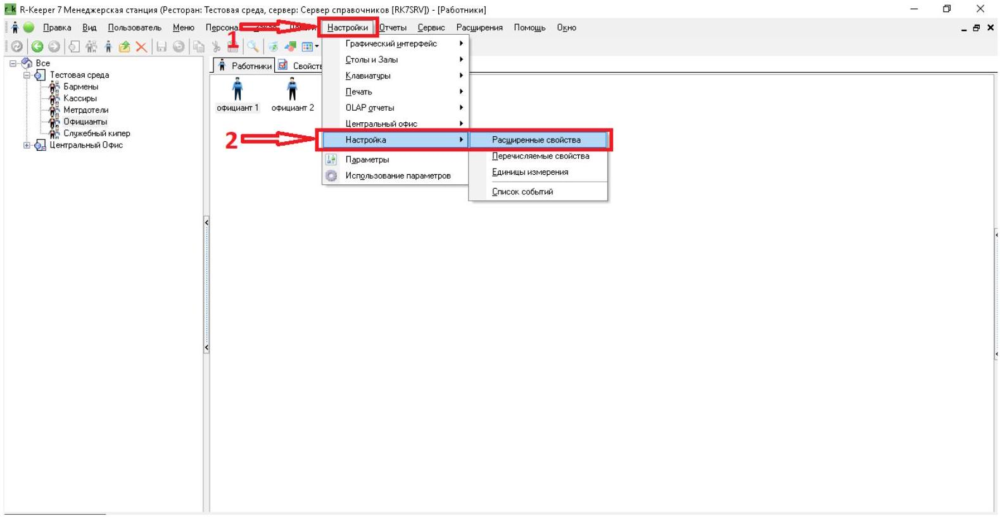
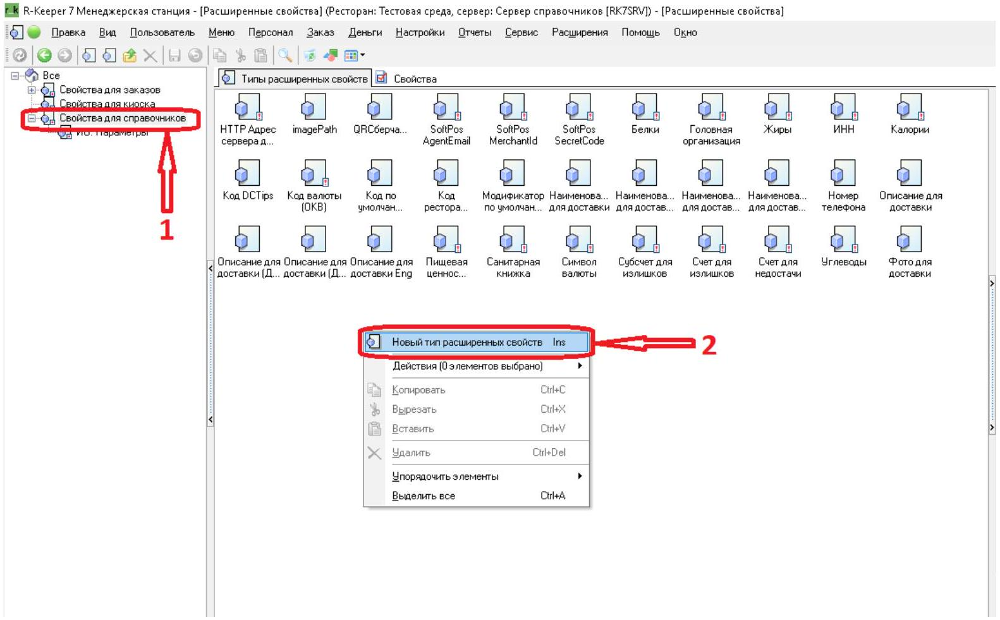
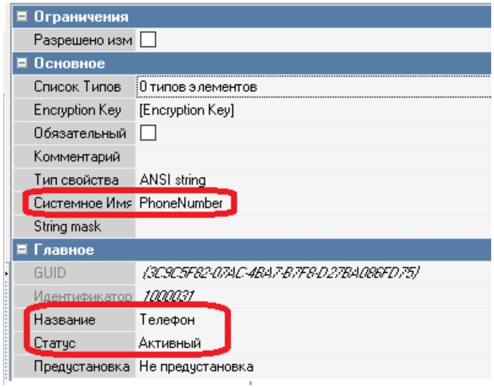
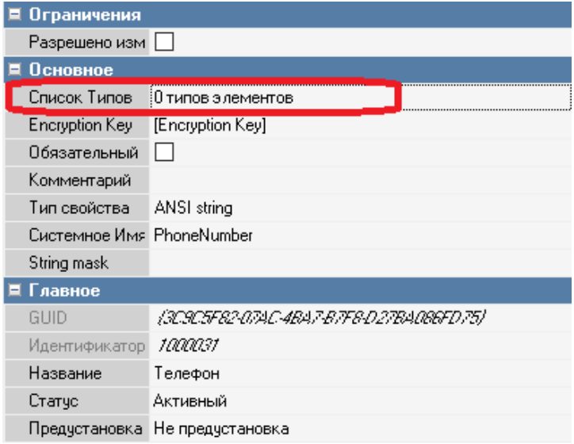
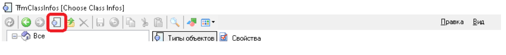
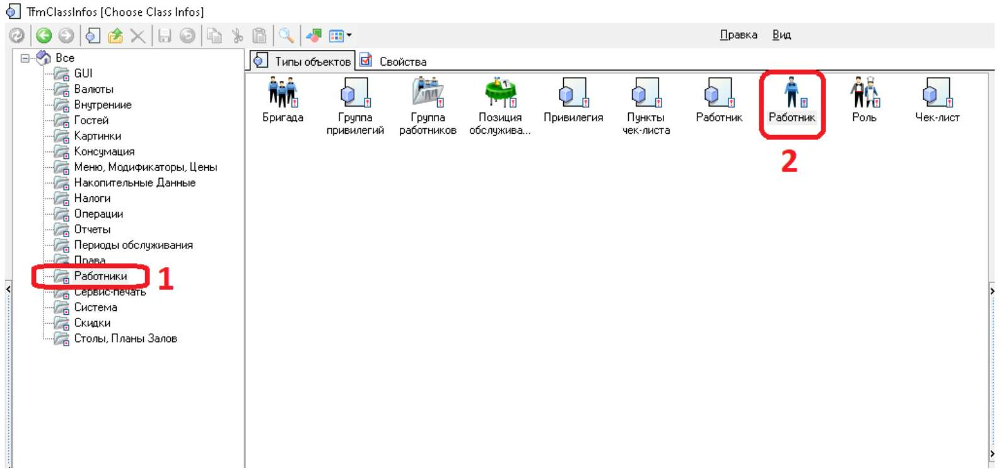
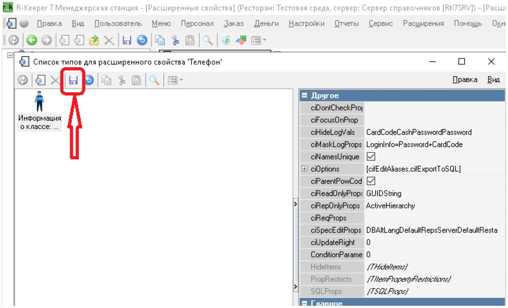

# RKEEPER: добавление номера телефона сотрудника для чаевых

# RKEEPER: добавление номера телефона сотрудника для чаевых

> 📱 <b>Куда вводить номер: поле «Телефон» в расширенных свойствах сотрудника.</b>
>
> Если поля <b>«Телефон»</b> нет, сначала добавьте его по шагам <b>4–10</b>, затем вернитесь к шагу <b>3</b>.

## 1. Откройте список сотрудников

В менеджерской станции <b>RKEEPER</b> откройте верхнее меню <b>«Персонал» → «Работники»</b>.

## 2. Найдите сотрудников вашей точки

- Нажмите <b>«+»</b>, чтобы развернуть список точек.
- Найдите вашу точку и нажмите <b>«+»</b> рядом с ней, чтобы открыть список работников.
  

## 3. Введите номер в поле «Телефон»

Выберите нужного сотрудника и откройте его <b>расширенные свойства</b>.

Найдите поле <b>«Телефон»</b> и введите номер телефона этого сотрудника. Проверьте номер и <b>сохраните изменения</b>.

Формат: <b>7XXXXXXXXXX</b> или <b>8XXXXXXXXXX</b> — 11 цифр, без «+», пробелов, скобок и дефисов.

<b>Если поле уже есть и номер сохранён, настройка для этого сотрудника завершена.</b> Повторите шаг для остальных сотрудников, которым нужно добавить номер для чаевых.

## 4. Если поля «Телефон» нет — откройте настройки

Шаги <b>4–10</b> нужны только для добавления отсутствующего поля.

- Откройте <b>«Настройки» → «Расширенные свойства»</b>.
  

## 5. Создайте тип расширенного свойства

Выберите <b>«Свойства справочников»</b>. В области <b>«Типы расширенных свойств»</b> нажмите правой кнопкой мыши на свободное место и выберите <b>«Новый тип расширенных свойств»</b>.

## 6. Задайте название и системное имя

В правой части окна заполните свойства нового типа:

- <b>Название:</b> <code>Телефон</code>
- <b>Системное имя:</b> <code>PhoneNumber</code>
- <b>Статус:</b> <b>«Активный»</b>

Системное имя укажите точно: <b>PhoneNumber</b>. В этих настройках задаётся поле; сам номер сотрудника вводится на шаге <b>3</b>.

## 7. Откройте «Список типов»

Выберите поле <b>«Список типов»</b> и нажмите кнопку <b>«…»</b>.

## 8. Откройте выбор типа объекта

В левом верхнем углу открывшегося окна нажмите значок, показанный на скриншоте ниже.

## 9. Выберите объект «Работник»

Откройте раздел <b>«Работники»</b> и дважды нажмите на объект <b>«Работник»</b> в списке типов объектов.

## 10. Сохраните поле и вернитесь к сотруднику

Сохраните изменения и закройте окно настроек.

Вернитесь к шагу <b>3</b>: выберите сотрудника, найдите <b>«Телефон»</b> в его <b>расширенных свойствах</b>, введите номер и сохраните изменения.

