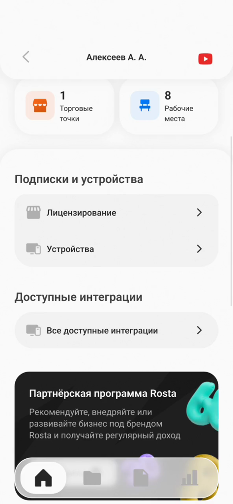
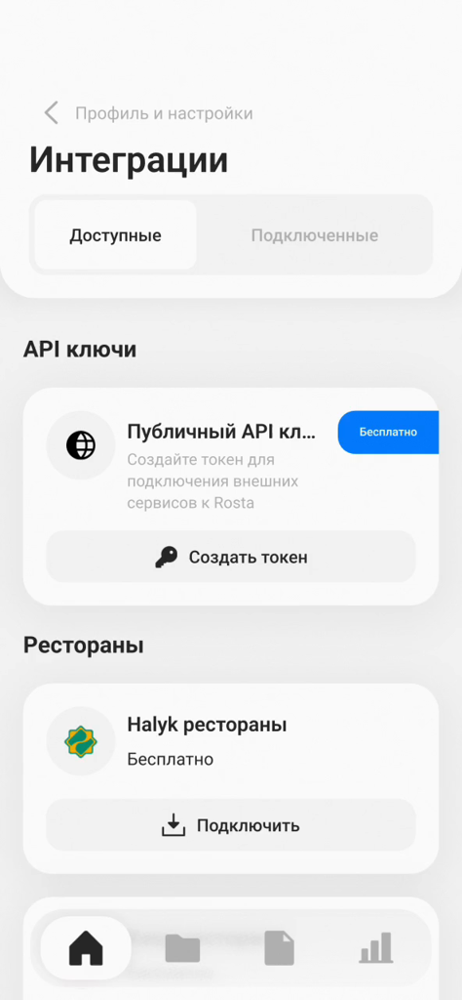
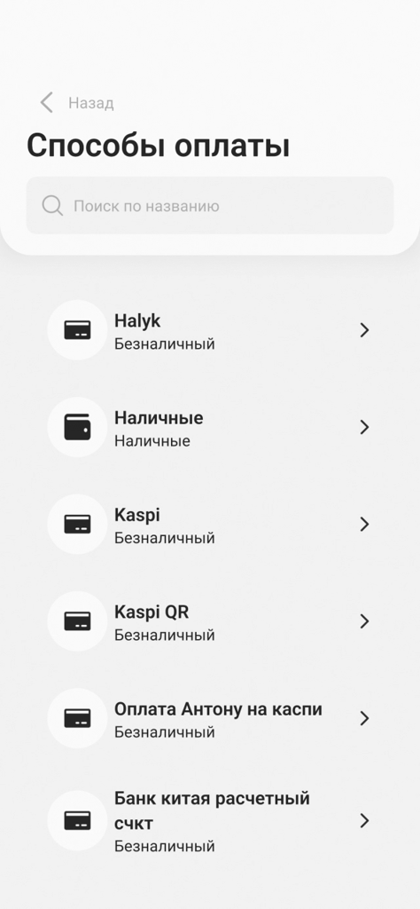
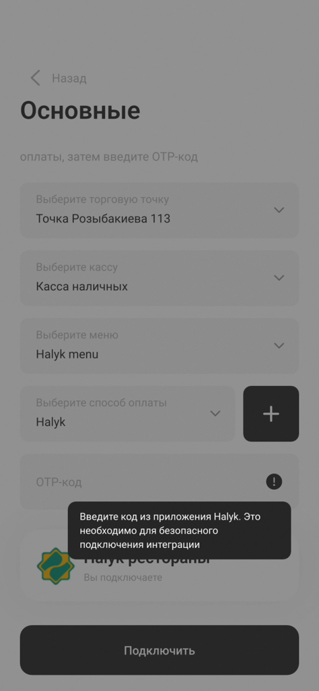

# ROSTA: подключение «Halyk рестораны»

Подключите «Halyk рестораны» самостоятельно через ROSTA Mobile Office. Подключение выполняется **со стороны ROSTA** — **владельцем** заведения (нужен доступ владельца к ROSTA Mobile Office).

- Версия ПО ROSTA на объекте должна быть **не ниже 1.13.9**.
- Обновите ROSTA до актуальной версии, если используется более ранняя версия.
- Определите торговую точку, кассу и меню для подключения.
- Убедитесь, что в ROSTA создан нужный способ оплаты Halyk.
- Подготовьте доступ к приложению Halyk, из которого нужно взять OTP-код.

> ⚠️ **Важно:** названия точки, кассы и меню в видео — примеры. Выберите данные своего заведения.

## Порядок подключения

### 1. Откройте доступные интеграции в ROSTA Mobile Office

Откройте **ROSTA Mobile Office** и перейдите в профиль. Прокрутите страницу до блока «Доступные интеграции» и нажмите «Все доступные интеграции».

### 2. Выберите «Halyk рестораны»

На странице «Интеграции», во вкладке «Доступные», найдите «Halyk рестораны» и нажмите «Подключить». Откроется форма «Основные».

### 3. Выберите торговую точку

Нажмите «Выберите торговую точку» и выберите точку, которую подключаете. В видео выбрана «Точка Розыбакиева 113».

### 4. Выберите кассу

Нажмите «Выберите кассу» и выберите нужную кассу. В видео выбрана «Касса наличных».

### 5. Выберите меню

Нажмите «Выберите меню» и укажите меню для интеграции. В видео выбрано «Halyk menu».

### 6. Выберите способ оплаты

Нажмите «Выберите способ оплаты» и выберите «Halyk». В списке видео этот способ оплаты имеет тип «Безналичный».

### 7. Введите OTP-код

Нажмите поле «OTP-код» и введите код из приложения Halyk. Подсказка рядом с полем объясняет, что код необходим для безопасного подключения интеграции.

## Проверка перед подключением

- [ ] Версия ПО ROSTA — **1.13.9 или выше**.
- [ ] Подключение выполняется через **ROSTA Mobile Office**.
- [ ] Выбрана нужная торговая точка.
- [ ] Выбрана правильная касса.
- [ ] Выбрано меню для интеграции.
- [ ] Способ оплаты — «Halyk».
- [ ] OTP-код взят из приложения Halyk и введён в соответствующее поле.

## Завершение

Проверьте параметры и нажмите «Подключить».

Далее — выбор POS-терминала Halyk и привязка столов: см. [«3. Подключение»](../../onboarding/03-connection/README.md) и [«4. Привязка столов»](../../onboarding/04-tables/README.md).

## Если возник вопрос

- **Интеграция «Halyk рестораны» не отображается?** Сначала проверьте версию ПО ROSTA. Для самостоятельного подключения требуется версия **1.13.9 или выше**.
- **Откуда взять OTP-код?** Из приложения Halyk — это указано в подсказке к полю.
- **Нужного способа оплаты нет?** Создайте или настройте способ оплаты Halyk в ROSTA, затем вернитесь к подключению.
- **Не отображается нужная торговая точка, касса или меню?** Проверьте их настройки в ROSTA до запуска интеграции.

## Официальная инструкция ROSTA

[Инструкция по самостоятельной интеграции](https://academy.rosta.kz/?article=f45ca3e3-be09-4144-903e-1794ea994002)

## Связанная инструкция

[ROSTA: добавление номера телефона сотрудника для чаевых](tips-employee-phone.md)
