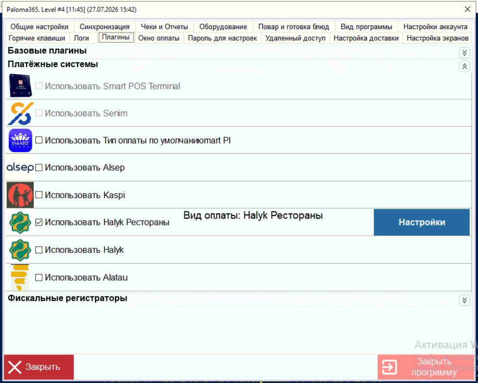

> 🎯 **Цель:** подготовить всё внутри Paloma365 до выхода на портал онбординга: вид оплаты, при необходимости внешнее меню (оно выбирается в плагине уже на этом этапе) и телефоны сотрудников для чаевых. **Для кого:** инженер, подключающий ресторан на Paloma365 · Этап 2 из 8. Начинайте только после этапа «1. Требования — Paloma365». **Следующий шаг:** «3. Подключение — Paloma365» (портал онбординга).

---

# Перед началом

## Обновите ПО до актуальной версии

1. На кассе откройте **«МЕНЮ» → «Настройки»**, введите пароль `00000` (пароль может быть изменён).
2. Перейдите во вкладку **«Настройки аккаунта»**.
3. Нажмите **«Обновить программу»**.

## Включите плагин

1. После обновления откройте **«Меню» → «Настройки» → вкладка «Плагины»**.
2. В блоке **«Платёжные системы»** включите **«Использовать Halyk Рестораны»**.
3. Кнопка **«Настройки»** в строке плагина открывает **окно плагина** (поля «Pairing Code», «Вид оплаты», «Меню»; кнопки «Применить» / «Отмена»).

> ℹ️ В окне плагина есть поле для **кода подключения** (Pairing Code) — код вы получите на портале на этапе «3. Подключение — Paloma365» (для Paloma365 на портале выбирается ERP **Universal API**).

Данные для портала и выезда (КЦ / сервисант)

**КЦ вносит в Таблицу по привлечению:** название ресторана; БИН; формат (кафе или точка на вынос; если обслуживание сразу на кассе — **не подходит**); ERP — Paloma365; адрес точки; контакт ответственного.

**Сервисант перед выездом:** созванивается с рестораном и подтверждает готовность; создаёт чат; получает данные по Paloma365 — доступ к настройкам кассы (пароль), доступ к веб-интерфейсу Paloma365 (для меню), нумерация столов.

**Для портала:**

- **БИН**, **адрес** точки и соответствующий **ID терминала**.
- **Terminal ID** физического POS-терминала Halyk, которым ресторан фактически принимает оплаты: [HALYK POS: Инструкция по получению Terminal ID](../../guides/common/halyk-pos-terminal-id.md)
- Столы созданы в Paloma365; нумерация в Paloma365 = фактическая; подготовлены физические QR-коды и схема столов (для режима «По столам»).
- Telegram-группа сотрудников и возможность добавить бота **@HalykRestaurantBot** администратором.
- Карточка ресторана: ссылка 2ГИС (без пробелов и лишних символов), логотип при наличии; управляющий готов проверить карточку и выбрать функции.
- Для чаевых: у официантов есть карта Halyk Bank; телефоны сотрудников внесены в Paloma365 (шаг 3).

---

# Шаг 1. Вид оплаты и настройки доставки

1. В окне плагина Halyk Рестораны выберите существующий или создайте новый (кнопка **«+»**) **вид оплаты** для Halyk Рестораны, например «Halyk Рестораны».
2. Нажмите **«Применить»**.

> ⚠️ **Не выбирайте вид оплаты «картой».**

**Только если ресторану нужна доставка / самовывоз:** в настройках кассы (**«Меню» → «Настройки»**) откройте вкладку **«Настройка доставки»**:

- **Сокет URL:** `wss://socket.paloma365.com:81` → нажмите **«Сохранить Сокет URL»**;
- включите **все** настройки для работы с доставкой (все обязательны: «Заявка на доставку», «Отображать все заказы в списке», «Отображать кнопки: создать счет, распечатать», «Пользовательский звук уведомлений», «Расширенное окно заявки»).

> ✅ Готово, если: вид оплаты выбран в плагине и это не «картой»; для доставки — Сокет URL сохранён, настройки доставки включены.

---

# Шаг 2. Внешнее меню (если нужны меню или самовывоз)

| Функции ресторана | Нужно ли внешнее меню |
| --- | --- |
| Базовая QR-оплата на столе, чаевые, вызов официанта, Telegram, бронирование | **Нет** — шаг пропустите |
| **Меню** (гость видит категории, блюда и цены в карточке ресторана в Halyk SuperApp) | **Да** |
| **Самовывоз** (гость оформляет заказ из меню, заказ поступает на кассу) | **Да** + настройки доставки (шаг 1) |

**Ограничения:**

- 🚫 **только 1 уровень меню** — вложенные уровни не допускаются;
- **API-ключ для Paloma365 не вводится** — на портале на шаге API-ключа нажмите **«Пропустить шаг»**.

**Когда:** для Paloma365 меню создаётся **и выбирается сейчас, на этапе 2**: создайте меню в веб-интерфейсе Paloma365 и выберите его на кассе в окне плагина Halyk Рестораны (поле **«Меню»**) — без этого меню не будет работать с сервисом. Пошагово: [Внешнее меню Paloma365](../../guides/paloma365/external-menu.md).

На портале меню для Paloma365 не выбирается; на этапе [«7. Внешнее меню»](../07-external-menu/r_keeper-poster-paloma365-rosta.md) меню только проверяется.

---

# Шаг 3. Телефоны сотрудников для чаевых

Внесите телефоны официантов в личном кабинете Paloma365: **«Сотрудники»** → **«Изменить»** → поле **«Телефон»**. Формат и пошаговая инструкция: [Paloma365: добавление номера телефона сотрудника для чаевых](../../guides/paloma365/tips-employee-phone.md)

> ℹ️ На этапе 8 телефоны только проверяются и включаются чаевые.

---

# ✅ Чек-лист этапа

- [ ] Требования этапа 1 выполнены (счёт Halyk, активный POS, MCC 5411/5441/5462/5812/5813/5814/7996/7999, обслуживание за столом, интернет).
- [ ] С рестораном созвонились, готовность подтверждена, чат создан; данные внесены в Таблицу по привлечению.
- [ ] БИН, адрес, Terminal ID физического POS известны; столы и QR-коды подготовлены.
- [ ] Управляющий будет на месте; функции согласованы; Telegram-группа создана или выбрана.
- [ ] ПО Paloma365 обновлено до актуальной версии.
- [ ] Плагин «Использовать Halyk Рестораны» включён.
- [ ] Вид оплаты для Halyk Рестораны выбран / создан — **не «картой»**.
- [ ] Для доставки / самовывоза — Сокет URL `wss://socket.paloma365.com:81` сохранён, настройки доставки включены.
- [ ] Если нужны «Меню» или «Самовывоз»: меню 1 уровня создано и сохранено в веб-интерфейсе и выбрано на кассе в плагине Halyk Рестораны.
- [ ] Телефоны сотрудников для чаевых внесены в Paloma365 (шаг 3).

> ✅ Все пункты отмечены — переходите к этапу «3. Подключение — Paloma365».

---

Предыдущий этап: «1. Требования — Paloma365» · Следующий этап: «3. Подключение — Paloma365»
