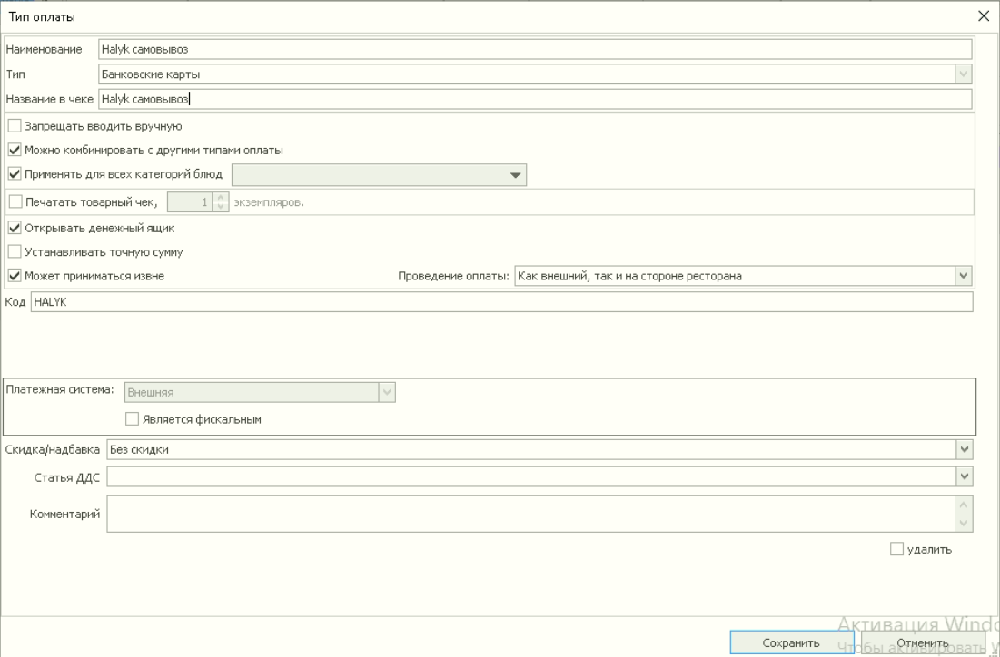

# iiko — создание типа оплаты для заказов на самовывоз Halyk Рестораны

## iiko — создание типа оплаты для заказов на самовывоз Halyk Рестораны

Инструкция для инженера или сотрудника ресторана, который настраивает тип оплаты заказов на самовывоз из Halyk Рестораны в iiko.

> ℹ️ **Результат:** в iiko создан и сохранён тип оплаты **«HALYK самовывоз»**. При использовании iikoChain указаны торговые точки, в которых он будет применяться.

# 1. Перед началом

| Что требуется | Что проверить |
| --- | --- |
| Доступ в iikoOffice или iikoChain | Сотрудник может авторизоваться в системе ресторана. |
| Доступ к типам оплат | Доступен раздел **«Розничные продажи» → «Типы оплат»**. В исходнике указано право **«Просматривать типы оплаты» — B\_APT**. |
| Возможность создания и сохранения | Учётная запись позволяет создать и сохранить тип оплаты. Если действие недоступно, обратитесь в техническую поддержку дилера iiko. |
| Торговые точки для iikoChain | Известны точки, в которых будет использоваться самовывоз Halyk Рестораны. |

> ⚠️ **B\_APT — право просмотра.** П**раво «Просматривать типы оплаты» (B\_APT) выдаются в комплексе с правами администратора или менеджера бэк-офиса**, необходимые права должен проверить дилер iiko.

# 2. Войдите в iiko

1. На рабочем столе откройте **iikoOffice**.
2. Авторизуйтесь под учётной записью с необходимыми правами.
3. Если ресторан использует **iikoChain**, выполняйте настройку в системе, используемой для управления сетью.

# 3. Откройте типы оплат

1. Перейдите в раздел **«Розничные продажи»**.
2. Откройте **«Типы оплат»**.

# 4. Создайте тип оплаты

1. Откройте форму создания нового типа оплаты.
2. Укажите название **«HALYK самовывоз»**.
3. Сверьте настройки формы с исходным скриншотом ниже.
4. Сохраните тип оплаты.

   

> ⚠️ Введите код с точным наименованием: **HALYK**

**Ожидаемый результат:** тип оплаты **«HALYK самовывоз»** сохранён в списке типов оплат.

# 5. Если используется iikoChain — укажите торговые точки

> ℹ️ Этот этап выполняется при использовании **iikoChain**.

1. В настройках типа оплаты укажите торговые точки, в которых будет использоваться самовывоз Halyk Рестораны.
2. Проверьте, что выбраны нужные точки.
3. Сохраните изменения.

**Ожидаемый результат:** для типа оплаты указаны торговые точки, которым он предназначен.

# 6. Проверьте результат

- [ ] Тип оплаты создан.
- [ ] Название указано точно: **HALYK самовывоз**.
- [ ] Код типа оплаты точно: HALYK
- [ ] Настройки сохранены.
- [ ] При использовании iikoChain выбраны нужные торговые точки.

> ✅ После этих проверок создание типа оплаты завершено. Далее продолжите подключение меню и самовывоза по основной инструкции.

# 7. Проверка в составе подключения самовывоза

Для полного запуска самовывоза также нужны API-ключ, внешнее меню и настройка интеграции. Выполните их по связанным инструкциям ниже.

Перед тестом сотруднику на кассе потребуются права работы с доставкой. Их настраивает техническая поддержка дилера; набор зависит от выполняемых операций.

| Право из исходной инструкции | Назначение |
| --- | --- |
| D\_CND | Подтверждать доставки |
| D\_ED | Редактирование доставки |
| D\_MD | Управление доставкой |

После завершения интеграции выполните тестовый заказ на самовывоз по разделу 22 основной инструкции.

- [ ] Заказ поступил в iiko.
- [ ] Состав и сумма заказа корректны.
- [ ] Применён тип оплаты **«HALYK самовывоз»**.
- [ ] Заказ прошёл статусы до закрытия.
- [ ] Заказ завершился в Halyk Рестораны.

# 8. Если возникла проблема

| Проблема | Что проверить |
| --- | --- |
| Не открывается раздел «Типы оплат» | Права учётной записи, включая B\_APT. Для настройки прав обратитесь к дилеру iiko. |
| Нельзя создать или сохранить тип оплаты | Попросите дилера проверить права создания и сохранения. |
| В iikoChain тип оплаты не доступен нужной точке | Проверьте выбранные торговые точки и сохранение настроек. |
| В тестовом заказе применён другой тип оплаты | Проверьте создание «HALYK самовывоз», выбранную торговую точку и настройки подключения самовывоза по основной инструкции. |

# Связанные инструкции

- [Внешнее меню v2 и API Key](внешнее-меню-v2-и-api-key.md)
- [Подключение iiko к Halyk Рестораны — полная пошаговая инструкция](../архив/подключение-iiko-к-halyk-рестораны-полная-пошаговая-инструкция.md)
