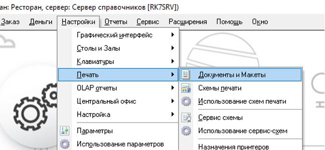
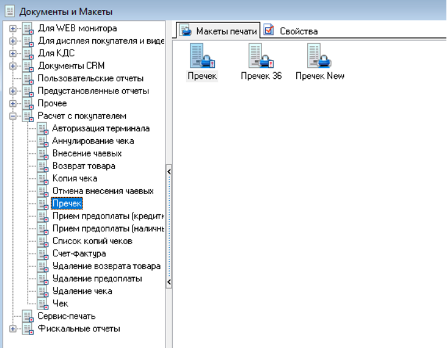
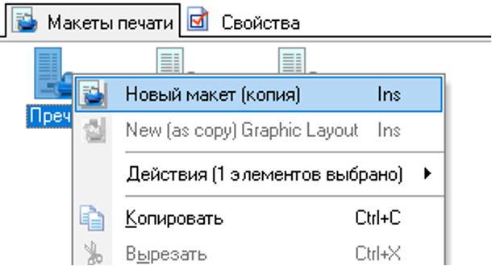
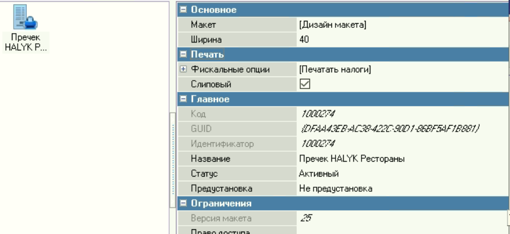
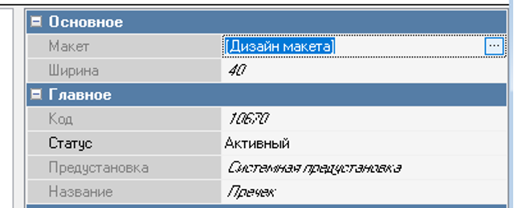
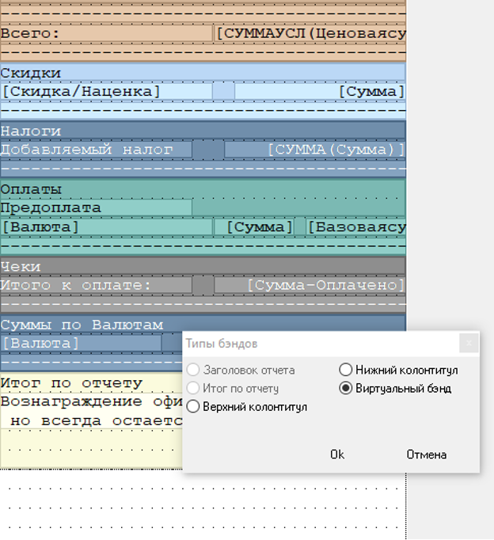
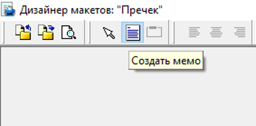
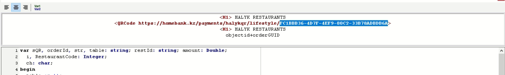
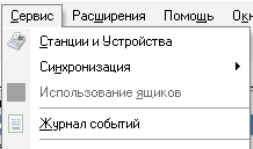
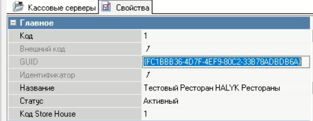

# Добавление QR в шаблон чека

1. Перейдите в меню «Настройки» → «Печать» → «Документы и макеты».

2. В меню слева выберите «Расчет с покупателем» → «Пречек».

3. Кликните правой кнопкой мыши по шаблону «Пречек» и нажмите «Новый макет (копия)»

4. Задайте имя для шаблона, например, Пречек HALYK Рестораны

5. Далее двойным кликом откройте «Основное» → «Макет» → «Дизайн макета».

6. В самом низу макета добавьте новый бэнд (band). Тип бэнда — «Вирутальный» (задается при создании).

8. В бэнд добавьте memo.

9. Откройте редактирование memo двойным кликом мыши и скопируйте подготовленный скрипт в нижнее окно редактора. 
10. в разделе HEAD вставьте полный GUID ресторана 

Для получения GUID - Сервис → Станции и устройства

