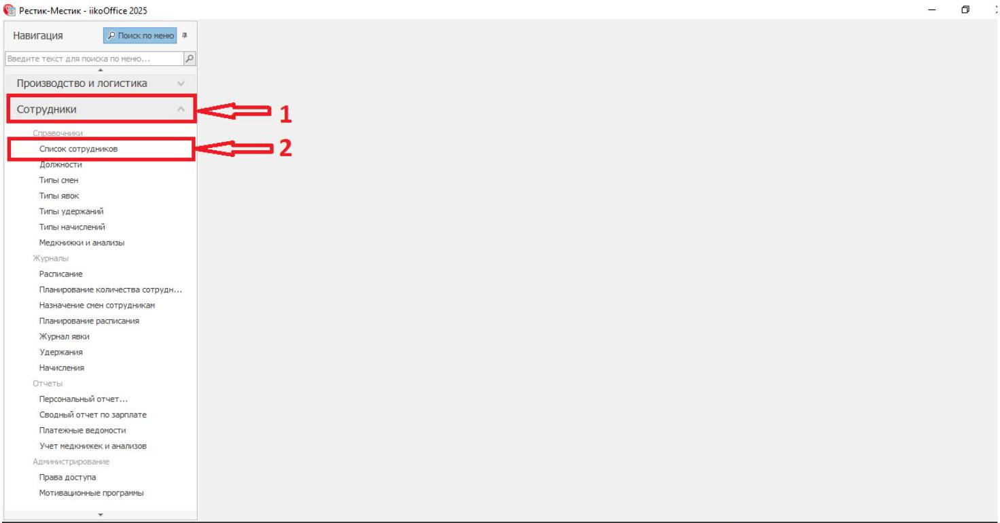
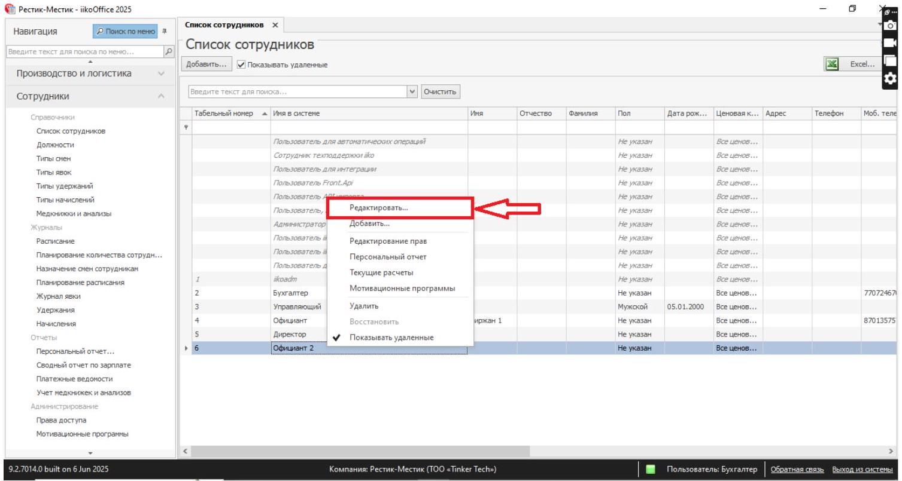
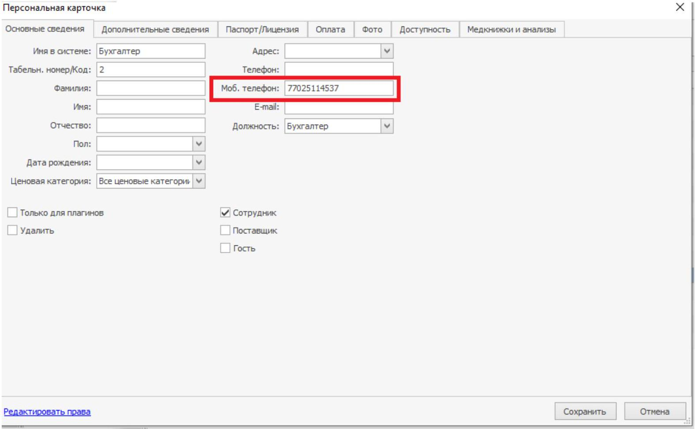

# iiko: добавление номера телефона сотрудника для чаевых

> 📱 **Куда вводить номер: поле «Моб. телефон» в карточке сотрудника.**
>
> Формат: **7XXXXXXXXXX** или **8XXXXXXXXXX** — 11 цифр, без «+», пробелов, скобок и дефисов.

## 1. Откройте список сотрудников

В **iikoOffice** откройте **«Сотрудники» → «Список сотрудников»**.

## 2. Выберите нужного сотрудника

Найдите сотрудника, которому нужно добавить номер для чаевых. Нажмите на него правой кнопкой мыши и выберите **«Редактировать»**.

## 3. Введите номер в поле «Моб. телефон»

В открывшейся карточке сотрудника найдите поле **«Моб. телефон»** и укажите в нём номер телефона этого сотрудника.

**Заполняйте именно поле «Моб. телефон».**

Номер должен соответствовать формату **7XXXXXXXXXX** или **8XXXXXXXXXX**: 11 цифр. Вводите только цифры, без «+», пробелов, скобок и дефисов.

**На скриншоте ниже ориентируйтесь на название поля «Моб. телефон».**

## 4. Проверьте номер и сохраните изменения

Убедитесь, что открыта карточка нужного сотрудника, номер указан в поле **«Моб. телефон»** и соответствует формату **7XXXXXXXXXX** или **8XXXXXXXXXX**. Нажмите **«Сохранить»**.

Если нужно добавить номера нескольким сотрудникам, повторите эти шаги для каждого.
