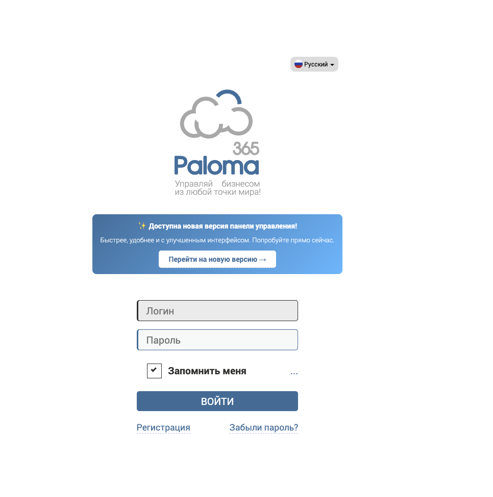
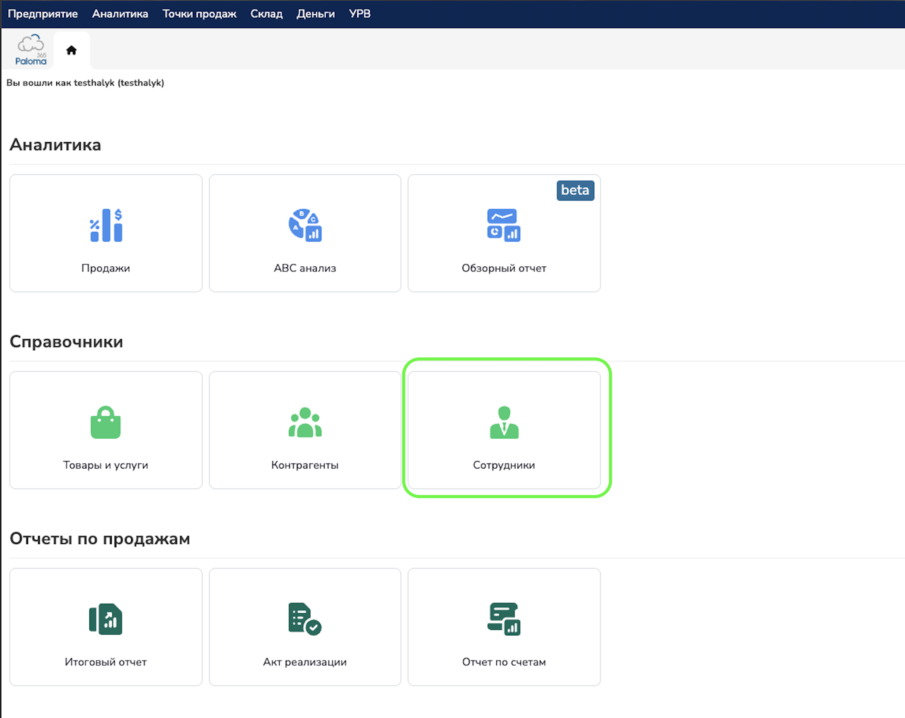
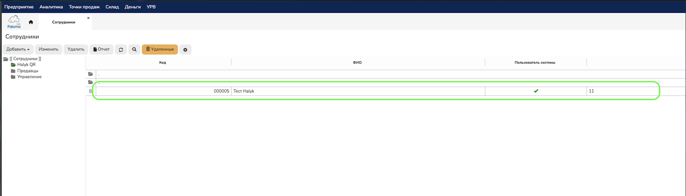
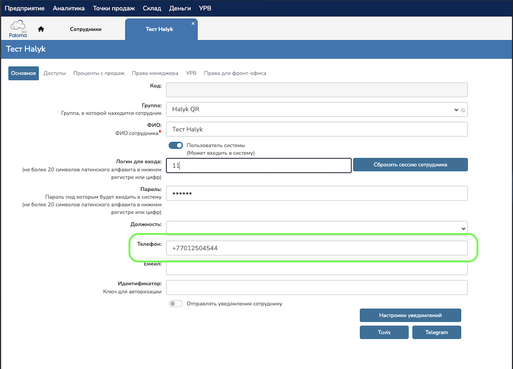

# Paloma365: добавление номера телефона сотрудника для чаевых

# Paloma365: добавление номера телефона сотрудника для чаевых

> 📱 **Куда вводить номер: поле «Телефон» в карточке сотрудника.**
>
> Укажите **мобильный номер сотрудника, привязанный к банку**.

## 1. Войдите в личный кабинет

Авторизуйтесь в личном кабинете **Paloma365**.

## 2. Откройте список сотрудников

Перейдите в раздел **«Сотрудники»**.

## 3. Откройте карточку сотрудника

Выберите нужного сотрудника и нажмите **«Изменить»**.

## 4. Введите номер в поле «Телефон»

В карточке сотрудника найдите поле **«Телефон»** и укажите мобильный номер этого сотрудника, **привязанный к банку**.

Формат: **7XXXXXXXXXX** или **8XXXXXXXXXX** — 11 цифр, без «+», пробелов, скобок и дефисов.

**Заполняйте именно поле «Телефон».**

## 5. Проверьте номер и сохраните изменения

Убедитесь, что открыта карточка нужного сотрудника и в поле **«Телефон»** указан его мобильный номер, привязанный к банку. Нажмите **«Сохранить и закрыть»**.

Если нужно добавить номера нескольким сотрудникам, повторите шаги **3–5** для каждого.
