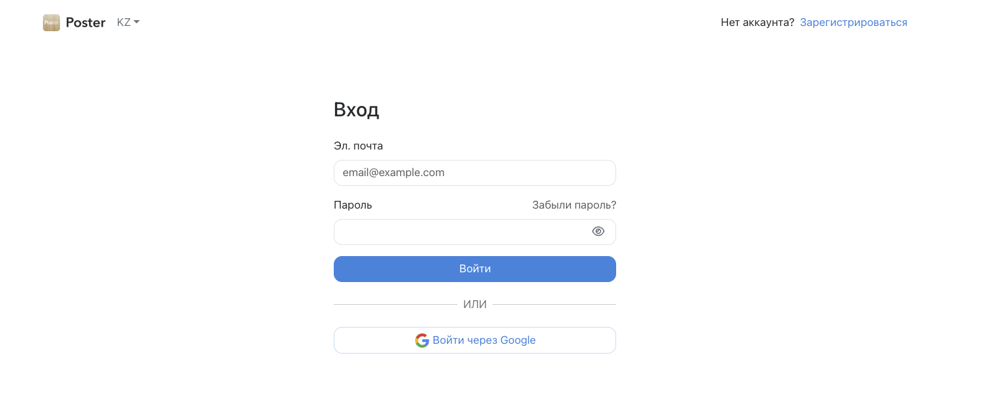
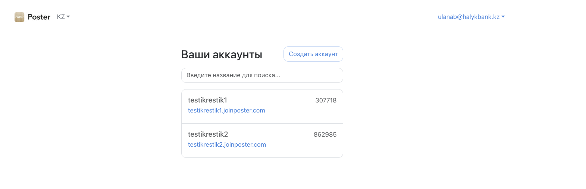
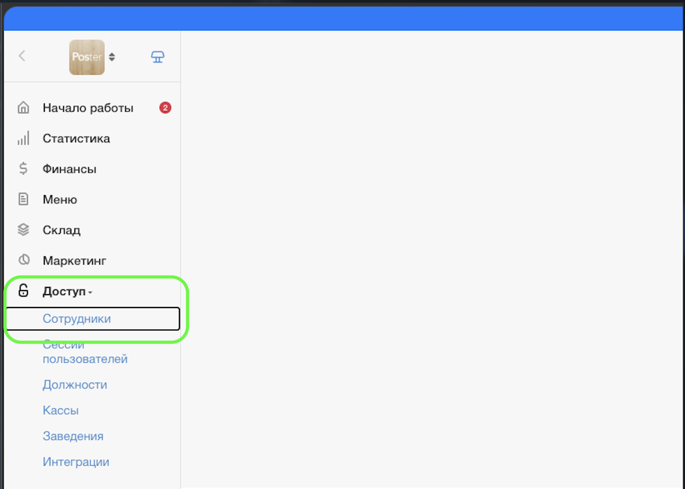
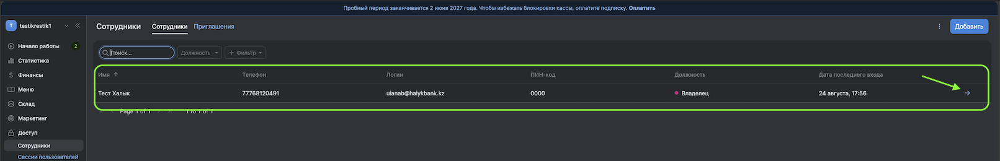
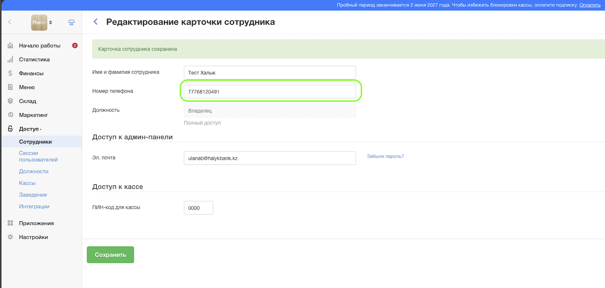

# POSTER: добавление номера телефона сотрудника для чаевых

> 📱 **Куда вводить номер: поле для номера телефона в карточке сотрудника.**
>
> Перед заполнением проверьте, что выбраны **нужная организация и нужный сотрудник**. После ввода номера обязательно **сохраните изменения**.

## 1. Войдите в личный кабинет

Авторизуйтесь в личном кабинете **Poster**.

## 2. Выберите нужную организацию

Если в личном кабинете доступно несколько организаций, выберите ту, в которой работает сотрудник, и перейдите в неё.

**Проверьте организацию до редактирования карточки сотрудника.**

## 3. Откройте список сотрудников

В админ-панели перейдите в **«Доступ» → «Сотрудники»**.

## 4. Откройте карточку сотрудника

Найдите нужного сотрудника и откройте его карточку. **Проверьте имя сотрудника**, прежде чем добавлять номер.

## 5. Введите номер телефона и сохраните изменения

В карточке сотрудника найдите **поле для номера телефона** и укажите номер этого сотрудника.

Формат: **7XXXXXXXXXX** или **8XXXXXXXXXX** — 11 цифр, без «+», пробелов, скобок и дефисов.

Проверьте все цифры и нажмите **«Сохранить»**.

**Важно: номер должен принадлежать сотруднику, чью карточку вы редактируете.**

Если нужно добавить номера нескольким сотрудникам, повторите шаги **4–5** для каждого. При переходе к другой организации сначала выберите её на шаге **2**.
