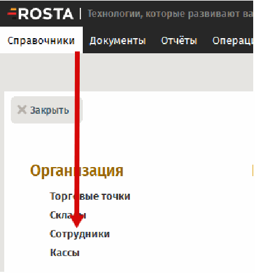
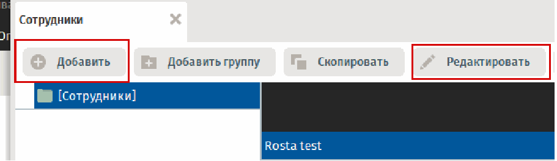
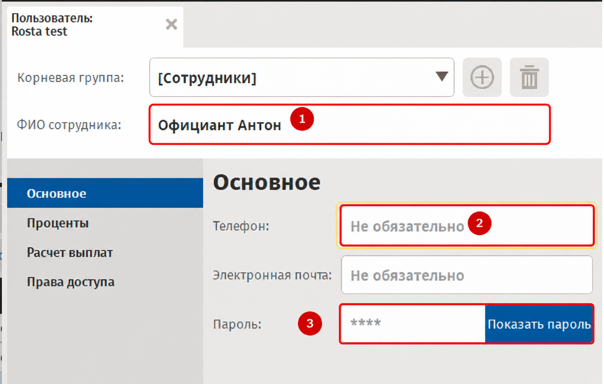
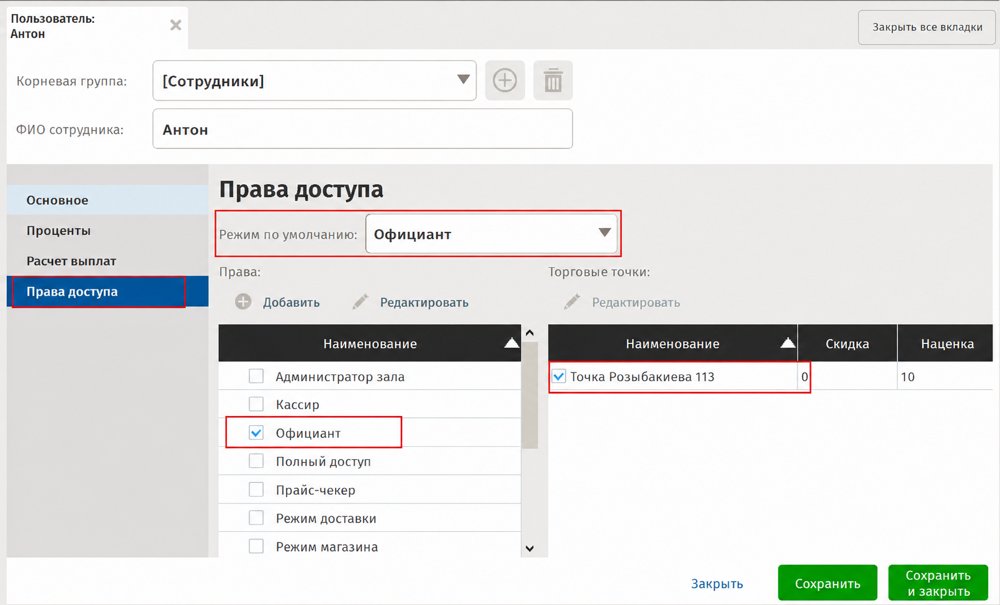

# ROSTA: добавление номера телефона сотрудника для чаевых

## ROSTA: добавление номера телефона сотрудника для чаевых

> 📱 **Куда вводить номер: поле «Телефон» на вкладке «Основное» в карточке сотрудника.**
>
> **Заполните телефон, даже если в поле отображается подсказка «Не обязательно».** В инструкции Rosta номер телефона указан среди обязательных данных сотрудника.

## 1. Откройте список сотрудников

В Rosta перейдите в **«Справочники» → «Сотрудники»**.

## 2. Откройте или создайте карточку сотрудника

Выберите нужного сотрудника и нажмите **«Редактировать»**. Если сотрудник ещё не создан, нажмите **«Добавить»**.

**Проверьте, что редактируете карточку нужного сотрудника.**

## 3. Введите номер в поле «Телефон»

В карточке сотрудника откройте вкладку **«Основное»**. Найдите поле **«Телефон»** и укажите номер телефона этого сотрудника.

Формат: **7XXXXXXXXXX** или **8XXXXXXXXXX** — 11 цифр, без «+», пробелов, скобок и дефисов.

**Заполняйте именно поле «Телефон», несмотря на подсказку «Не обязательно».**

При создании карточки также заполните обязательные данные, перечисленные в исходной инструкции: **«ФИО сотрудника»** и **«Пароль»**.

**На скриншоте обязательные поля обведены красным. Поле «Телефон» дополнительно выделено жёлтым.**

## 4. Проверьте права доступа

Перейдите на вкладку **«Права доступа»**. При создании сотрудника задайте, а при редактировании проверьте:

- **«Режим по умолчанию»** — режим, который открывается для сотрудника.
- **Роль сотрудника** в списке прав.
- **Торговую точку**, в которой он будет работать.

На примере в исходной инструкции выбран режим и роль **«Официант»**. Укажите настройки, соответствующие работе вашего сотрудника.

**Красными рамками выделены режим по умолчанию, роль и торговая точка.**

## 5. Проверьте данные и сохраните изменения

Убедитесь, что номер указан в поле **«Телефон»** у нужного сотрудника, а торговая точка и права доступа настроены корректно. Нажмите **«Сохранить»** или **«Сохранить и закрыть»**.

Если нужно добавить номера нескольким сотрудникам, повторите шаги **2–5** для каждого.

---
