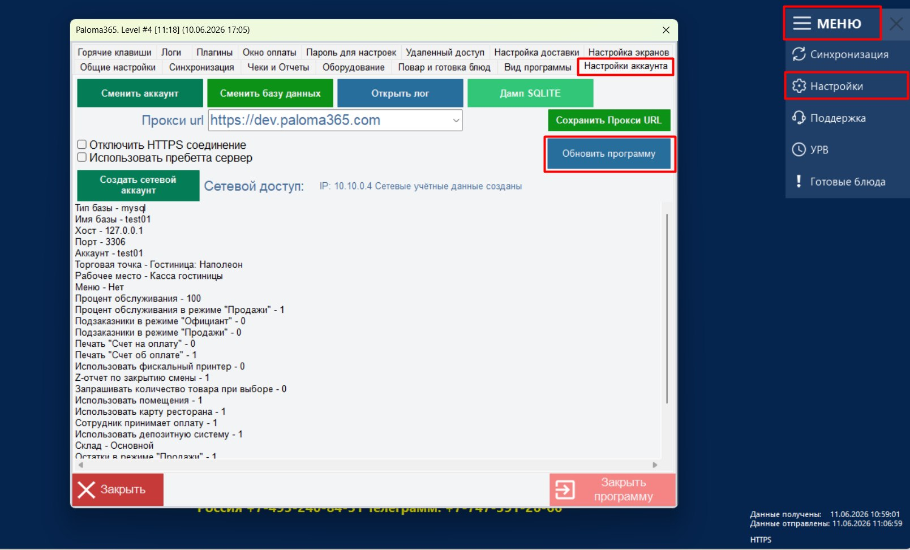
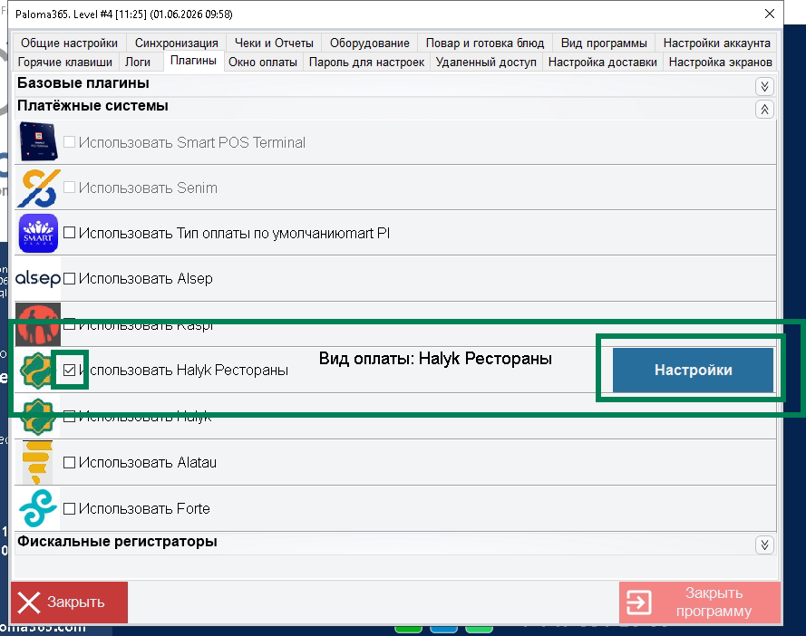
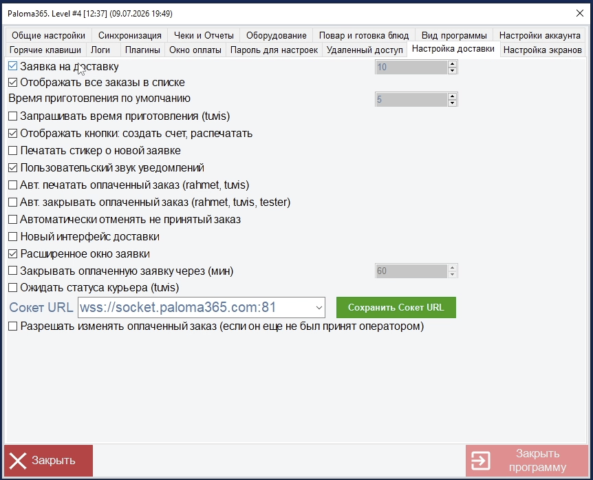
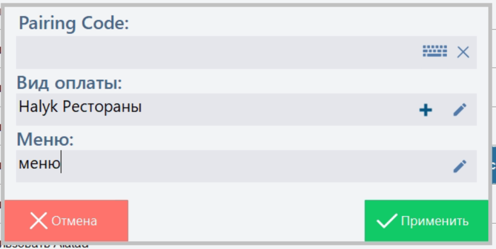

# Процесс онбординга Paloma365

**Инженер приезжает на точку для онбординга**

# **Для QR оплаты на столах**

1️⃣ **Нужно обновить ПО до актуальной версии.**

Для этого зайти на кассу. МЕНЮ-Настройки - Пароль “00000” прим. пароль может быть изменен

Далее зайти во вкладку настройки аккаунта во вкладке настройки аккаунта нажать “Обновить программу”

после обновления. Необходимо зайти в Меню → Настройки → Плагины → Использовать Halyk Рестораны

Ввести код для подключения

В данном окне необходимо указать код для подключения

выберите или создайте Вид оплаты (не выбирать картой)

Для работы с доставкой необходимо включить настройки

**2️⃣ Начать онбординг: ссылка на онбординг**:

[`https://lifestyle.halykbank.kz/service-man/`](https://lifestyle.halykbank.kz/service-man/)

**3️⃣ Ввести БИН → Отправить → Создать новую заявку  → Выбрать адрес и ID терминала**

**4️⃣ Выбрать ERP систему Universal API → ввести КОД на кассе → нажать ОК на кассе → нажать Начать интеграцию в портале онбординга**

‼️Дождаться сбора информации и нажать **Далее**‼️

**5️⃣ Необходимо выбрать терминал** на котором будут отображаться оплаты Халык рестораны

💡[`Инструкция по получению номера POS терминала Halyk`](../03-подключение/halyk-pos-инструкция-по-получению-terminal-id.md)

**6️⃣ Необходимо** **подвязать столы**

‼️QR предназначенные для столов нельзя привязать к карточке ресторана‼️

Выбрать режим подвязки QR

1️⃣ **ОБЩИЙ** - это гиперссылка на профиль ресторана в HSA

**2️⃣ По столам** - подвязка QR к физическим столам

‼️Необходимо подвязать **физические** **столы** с QR Халык рестораны‼️

‼️Необходимо соблюдать нумерацию столов ‼️

‼️Правила работы с QR-кодами Halyk рестораны и столами:‼️

1. Не переставляйте QR-коды между столами — иначе гость увидит чужой заказ.
2. Официанты должны отправлять заказ гостя на тот стол, за которым он действительно сидит.
3. Официанты должны создавать заказ от своего имени для получения чаевых.
4. При потере или поломки QR кодов и при технических проблемах уведомить представителей Halyk банк в чате.

**7️⃣ Необходимо настроить телеграм группу:**

💡 [`ссылка для настройки группы в телеграме`](настройка-telegram-группы-для-получения-уведомлений.md)

Плюсы для гостей: оперативный вызов официанта через QR

Уведомления об заказах на самовывоз

Уведомления об оплатах заказов

Плюсы для заведения: все уведомления в одном месте

**8️⃣Совместно с управляющим заполните информацию о ресторане**

Необходимо корректно заполнить информацию о заведении.

Обязательно корректно заполните адрес и город вашего заведения

‼️Если есть лого заведения, загрузите его.‼️

‼️Проверьте ссылку из 2Гис что бы не было пробелов и лишних символов ‼️

**9️⃣ Настройки функций и тестовая оплата**

> 💡 *Меню*

> 💡 *Бронирование*

> 💡 [*`Чаевые`*](../08-настройка-функций/iiko-добавление-номера-телефона-сотрудника-для-чаевых.md)

> 💡 *Удаленный заказ*

> 💡 *Вызов официанта*

**Сделать тестовую оплату для завершения онбординга**

# Подключение меню для отображения гостям и для самовывоза

- Откройте веб-интерфейс Paloma365 и авторизуйтесь.
- На главной странице перейдите в раздел **«Меню»**.
- В списке меню создайте новое меню или выберите необходимое меню.
- Нажмите  “Добавить” для создания нового меню или “**Изменить”** (или дважды щелкните по нужному меню), чтобы открыть его для редактирования.
- В карточке меню при необходимости укажите:
  - название меню;
  - тип цены;
  - другие параметры меню.
    

Обязательное условие: 1 уровень меню, не больше (как на фото)

- Перейдите на вкладку со структурой меню (дерево категорий и блюд).
- В левой части окна выберите нужную категорию.
- В центральной части отобразится список товаров (блюд), входящих в выбранную категорию.
- Для просмотра информации о блюде выделите его в списке. При необходимости можно открыть карточку блюда двойным щелчком.
- После внесения изменений сохраните их с помощью кнопки **«Сохранить»**.

Далее что бы меню работало с сервисом Халык рестораны - необходимо на кассе его выбрать

